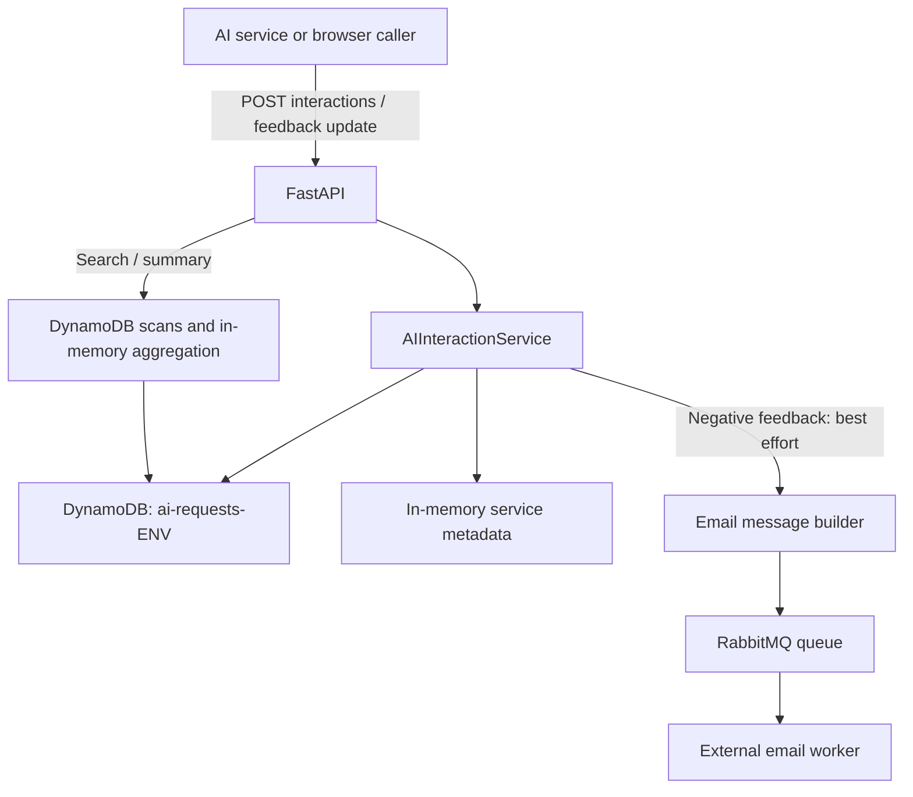

# AI Interaction Tracking and Feedback Service

Records AI interactions across services and optionally attaches positive/negative feedback. The active API stores records in **DynamoDB**, supports later feedback updates and exposes search and summary endpoints. Negative feedback can queue an email notification through RabbitMQ.

This guide describes `dev-feedback`. The inspected `main-feedback` service files currently match development; compare them again after integration. The service has no frontend and does not invoke an AI model to generate answers.

## Documentation

| Need | Guide |
| --- | --- |
| Install, configure and integrate | This README |
| Request fields, updates, search and errors | [API contract](docs/API.md) |
| Storage, startup, notifications and maintenance | [Technical documentation](docs/TECHNICAL_DOCUMENTATION.md) |
| Component boundaries and data flow | [Architecture](docs/HIGH_LEVEL_SOFTWARE_DESIGN.md) |
| Users, workflow and product limitations | [Product overview](docs/PRODUCT_OVERVIEW.md) |
| Promote changes safely | [Branch comparison](docs/BRANCH_DIFFERENCES.md) |
| Continue work as an agent | [Service instructions](AGENTS.md) |

## Quick start

Use Python 3.13 to match the Lambda base image. Start from the service directory:

```bash
cd ai-feedback-service
python3.13 -m venv .venv
.venv/bin/python -m pip install -r requirements.txt
cp .env.example .env
# Set AWS_REGION, ENV and AWS credentials/profile before starting.
.venv/bin/python api_server.py --host 127.0.0.1 --port 8001 --reload
```

Open `http://localhost:8001/docs` for generated OpenAPI or `/health` for process/service-registry status. The local launcher's actual default port is **8001**, although one help string says 8000. `main.py` exports `main.handler` for Lambda; it is not the local HTTP launcher.

**Startup contacts DynamoDB and may create a table.** Importing the application constructs the global service, loads `ai-requests-{ENV}` and creates it if absent. Use the intended AWS identity, region and exact environment suffix before starting; this is not an offline preview. Network-free documentation checks require fake AWS clients before importing the service.

Docker installs `requirements.txt`; `pyproject.toml` lists the same direct dependencies, but there is no tracked lockfile. Both lists are unpinned. S3/Bedrock are not the active interaction storage/model pipeline despite older descriptions in this repository.

## Configuration

Copy [.env.example](.env.example) without committing real credentials. [config_util.py](app/utils/config/config_util.py) loads environment values using python-dotenv.

| Setting | Actual use |
| --- | --- |
| `AWS_REGION` | Region for DynamoDB resource and client |
| `ENV` | Literal suffix of `ai-requests-{ENV}`; no default or enum validation. An unset value selects `ai-requests-None` |
| AWS credentials/profile/role | Standard SDK credential chain; active DynamoDB clients do not pass explicit access/secret keys |
| `RABBITMQ_URL`, `EMAIL_QUEUE_NAME` | Optional negative-feedback notification transport and durable queue |
| `MS_AUTH_USER`, `MS_AUTH_PASSWORD` | Authentication fields embedded in the downstream email-service message, separate from broker credentials in the URL |
| `EMAIL_SENDER`, `EMAIL_SENDER_NAME` | Notification sender fields |
| `EMAIL_RECIPIENT` | Comma-separated recipient list; whitespace trimmed |
| `BUCKET_NAME` | Only retained legacy S3 configuration; not used by the active DynamoDB service |

Choose an environment intentionally: branch names do not set `ENV`, and development is not automatically prevented from accessing production. DynamoDB access needs table read/write/scan permissions; automatic provisioning also needs table creation and describe permissions. RabbitMQ is contacted on negative-feedback notification attempts, not as a startup health dependency. An empty broker URL disables successful queueing; failed notifications do not roll back stored interactions.

## Integration: create, then attach feedback

Send one record after the AI service produces an answer. This writes to DynamoDB; the fictional payload below has no feedback, so it does not request an email notification.

```bash
curl -X POST http://localhost:8001/api/interactions \
  -H 'Content-Type: application/json' \
  -d '{
    "user_id": "demo-user",
    "service_name": "chatbot",
    "display_name": "Example Chatbot",
    "service_description": "Example reporting assistant",
    "session_id": "demo-session",
    "user_input": "Summarize the example records",
    "ai_output": "Example answer for documentation",
    "platform": "AICCRA",
    "context": {"filters_applied": {"phase": "AR 2025"}},
    "response_time_seconds": 2.5
  }'
```

Retain the returned `interaction_id` (format `req_<uuid>`). Later use the **same endpoint** with `update_mode=true`, that ID, the original `service_name` and a `feedback_type`:

```json
{
  "user_id": "demo-user",
  "service_name": "chatbot",
  "interaction_id": "req_550e8400-e29b-41d4-a716-446655440000",
  "update_mode": true,
  "feedback_type": "positive",
  "feedback_comment": "The example answer was useful."
}
```

`user_id` and `service_name` remain required in update requests. A true update flag without an ID currently creates a new record instead. The update path does not verify ownership or existence; use an ID actually returned for the same service. Comment-only updates are not a supported example because the current DynamoDB call can fail without a feedback type. See [update limitations](docs/API.md).

### Python example

```python
import requests

base_url = "http://localhost:8001"
response = requests.post(
    f"{base_url}/api/interactions",
    json={
        "user_id": "demo-user",
        "service_name": "example-service",
        "ai_output": "Example output",
    },
    timeout=30,
)
response.raise_for_status()
interaction_id = response.json()["interaction_id"]

feedback = requests.post(
    f"{base_url}/api/interactions",
    json={
        "user_id": "demo-user",
        "service_name": "example-service",
        "interaction_id": interaction_id,
        "update_mode": True,
        "feedback_type": "positive",
    },
    timeout=30,
)
feedback.raise_for_status()
print(feedback.json()["status"])
```

A client timeout is not a service latency guarantee. Retrying a create is not idempotent: each call generates another ID. Negative feedback attempts a real downstream notification when configured; API success does not prove email delivery.

## API navigation

| Method/path | Implemented purpose |
| --- | --- |
| `POST /api/interactions` | Create an interaction or update feedback |
| `GET /api/interactions/summary` | Counts, feedback/satisfaction rates and response-time average |
| `POST /api/interactions/search` | Filter, sort and paginate records in application memory after scans |
| `GET /api/feedback/services` | Process-local service registry |
| `GET /api/feedback/service/{service_name}` | Service-filtered interaction list, including entries without feedback |
| `GET /`, `GET /health` | Static metadata and in-memory registry information |
| `/docs`, `/redoc`, `/openapi.json` | Generated documentation/schema |

There is no `POST /api/feedback`, `/api/feedback/search`, `/api/feedback/summary` or HTTP registration route in the current router. Two read paths retain the `/api/feedback` prefix. Generated descriptions still contain older claims about replication/retention and health; code behavior is documented in the [API guide](docs/API.md).

## System architecture



The module creates its DynamoDB service during import. Storage uses the composite key `(interaction_id, service_name)` and provisions `ServiceTimestampIndex`, but current reads use paginated scans rather than that index. Details are in the [technical guide](docs/TECHNICAL_DOCUMENTATION.md).

Service metadata is not a durable global registry. `chatbot` is pre-registered per process. Request display name/description override metadata for that record; when either override is supplied, the service need not be added to the registry. Unknown names with neither override auto-register in that process. Restarting does not reconstruct the registry from stored data.

## Project map

```text
ai-feedback-service/
├── README.md / AGENTS.md
├── docs/                              # API, technical guide, architecture, product, branch comparison
├── api_server.py                      # Local Uvicorn launcher, port 8001
├── main.py                            # Mangum Lambda handler
├── Dockerfile                         # Lambda Python 3.13 image
├── requirements.txt / pyproject.toml   # Unpinned dependencies; no tracked lock
├── app/api/                           # FastAPI application, routes and models
├── app/utils/feedback/feedback_util.py # Active DynamoDB service
├── app/utils/feedback/feedback_util_s3.py # Inactive historical S3 implementation
├── app/utils/microservices/send_email.py # RabbitMQ email adapter
├── app/utils/config/                  # .env/config dictionaries
├── app/utils/logger/                  # Console + /tmp/logs/app.log
└── app/utils/s3/                      # Legacy helper with stale config import
```

## Operations and limitations

- The logger writes `/tmp/logs/app.log` and console at DEBUG, rotating at 5 MiB with five backups. `ENV=testing` does not switch to service-local logs; that alternative is commented out.
- `/health` uses the in-memory registry and a fixed historical timestamp. It does not probe DynamoDB or RabbitMQ. Application import must succeed first, so startup can still fail before health is available.
- Search accepts `has_feedback` but does not apply it. Use actual `feedback_type` filtering where appropriate; consult the contract before relying on nullable filters or sorting mixed records.
- Storage-read failures can be logged and converted into an empty result, making summaries/search appear empty instead of unavailable. Summary `recent_interactions` sorts the first ten scanned records, not necessarily the newest ten overall.
- Updates can leave derived metadata unchanged and are not an audit/version history. No HTTP authentication, record-ownership check or deletion/retention policy is implemented. CORS allows all origins and credentials; gateway access controls require separate verification.
- Questions, AI output, user identity, comments and context can be persisted and included in notification messages. IAM authorizes outbound AWS calls; it does not authenticate incoming users. Encryption, backups/replication and lifecycle settings must be verified in infrastructure rather than inferred from README descriptions.

The historical S3 implementation is not a supported fallback: it imports removed feedback models, and its upload helper imports a missing `S3` configuration symbol. Do not switch imports or install S3 settings just to satisfy old documentation.

## Troubleshooting

| Symptom | Check |
| --- | --- |
| App fails before serving health | AWS region/identity, ENV suffix, table access and startup create/load behavior |
| Data appears in an unexpected environment | `ENV` is interpolated literally; inspect the configured suffix, not the branch name |
| Empty search/summary | Check scan errors and logs before assuming there are no records |
| `has_feedback` search returns both kinds | The field is accepted but currently ignored |
| Feedback update creates another ID | `update_mode=true` without interaction_id enters create path |
| Comment-only update fails | Supply feedback_type with a known ID; the current expression-name argument can be None otherwise |
| Notification missing after successful save | Check RabbitMQ/recipient configuration and worker independently; notification success is not part of the response contract |
| Legacy S3 import fails | That path has stale config/model imports and is not active |

## Deployment and validation

`Dockerfile` uses the Lambda Python 3.13 image, installs requirements into `LAMBDA_TASK_ROOT` and starts `main.handler`. It copies `.env` and then the full service context. Review build inputs and keep real credentials, exports and reporting artifacts out of images/commits. This is the actual container definition, not a generic Uvicorn container recipe.

The workflow `.github/workflows/jenkins-trigger-ai-feedback.yml` triggers the `feedback-service` Jenkins job on push/PR to **main-feedback** and manual dispatch. A push to dev-feedback does not match that workflow's branch filters. Follow task branch → dev-feedback → main-feedback → staging → main, checking the current filters and pipeline at each integration.

No dedicated service test suite is tracked. Offline checks can validate links/examples, models, fake-DynamoDB create/update/search/summary behavior and fake RabbitMQ payloads. Read imports first and block network before import: starting the app against real configuration can create tables, write records or queue notifications. Such checks do not validate real permissions, table data, broker delivery, deployed infrastructure or Jenkins.
