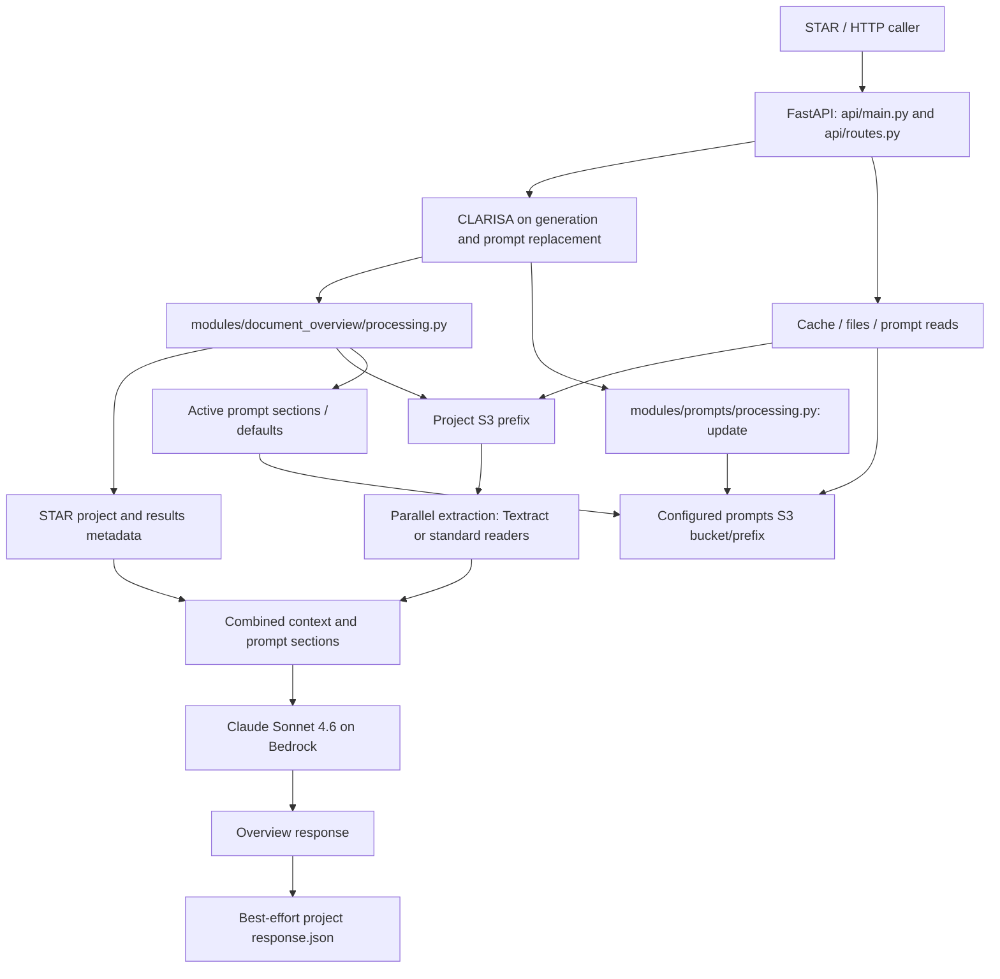

# AI Insights: high-level design

AI Insights is a FastAPI backend with project-overview and prompt-management modules. It reads project inputs from S3/STAR, extracts document text, assembles a managed prompt, calls Bedrock, and returns an overview with optional caching and analytics. It does not currently use MCP, embeddings, or a vector database.

See the [API guide](API_GUIDE.md) for contracts and the [backend README](../backend/README.md) for execution/configuration.

## Component flow

The read/deletion paths do not pass through the same CLARISA dependency as generation/update. The API layer owns Slack notifications; generation optionally records analytics when `user_id` is supplied.

## Source map

| Location under `backend/` | Responsibility |
| --- | --- |
| `api/main.py` | App, health/schema routes, runtime-specific CORS, global errors |
| `api/routes.py` | Public operations, authentication dependencies, envelopes, notifications |
| `api/models.py` | Request/response schemas |
| `modules/document_overview/processing.py` | Context assembly, extraction orchestration, inference, cache/analytics |
| `modules/prompts/processing.py` | Prompt normalization, validation, full replacement, rendering |
| `ai/prompts/registry.py` | Registered IDs, default sections, variable definitions |
| `ai/prompts/prompt_document_overview.py` | Shipped default prompt text |
| `ai/models/claude.py` | Lazy Bedrock client and Anthropic Messages invocation |
| `utils/s3/s3_util.py` | Project listing/read/delete/cache and prompt JSON storage |
| `utils/star/star_client.py` | STAR metadata retrieval and context formatting |
| `utils/textract/textract_util.py` | Synchronous/asynchronous OCR extraction |

## Generation flow

1. Validate the request envelope and CLARISA key. Read optional `Access-Token` from the header; it is not a JSON-body field.
2. Resolve active `project-overview` sections from prompt storage, with code defaults for missing/unreadable records.
3. Derive the contract ID from the final project-folder segment. Fetch STAR project information and results with the supplied token or configured fallback. Missing configuration/token skips enrichment; request failures are logged and can leave that context unavailable.
4. List S3 files under the project prefix. Exclude cache, folder markers, zero-size objects, and unsupported document formats from generation. Enforce at most three supported documents, or two when `text` is truthy.
5. Reject a request with no documents, no STAR context, and no user text. Listing still happens for text-only requests.
6. Extract documents in a thread pool, with worker count equal to the number of selected files. Extraction results are sorted by file key. A failed future propagates instead of silently dropping its document.
7. Enforce the combined extracted-document character limit, label the sources, and render four prompt sections with source/context substitutions.
8. Invoke Bedrock and parse JSON after removing Markdown fences. Invalid JSON falls back to a dictionary containing `raw_response`.
9. Attempt analytics when requested. Build the result, preserve received text, add a UTC generation timestamp, and attempt to save project `response.json`.
10. Attempt the route's Slack notification and serialize the response envelope.

The model is `us.anthropic.claude-sonnet-4-6`, with temperature 0.1 and default maximum output tokens 15,000. Output parsing and envelope validation do not establish factual correctness or enforce every prompt instruction.

## Extraction and context limits

PDF/TIFF sources use asynchronous Textract; JPG/JPEG/PNG use its synchronous text-detection path. Textract collects line blocks into text. Async polling uses a five-second interval and up to 60 attempts, separate from request/network timeouts.

DOCX uses Mammoth followed by HTML-to-text conversion; TXT is UTF-8 text; spreadsheet rows are cleaned and flattened; PPTX collects text from slide shapes. Content is combined directly rather than retrieved through embeddings.

The document-text guard is 3,000,000 combined characters. It excludes STAR/user-context contributions and is not a tokenizer-based validation of the complete model input. The current code does not trim `text` before deciding whether it counts as an input.

The listing helper makes one `list_objects_v2` call without a paginator. Its returned file list is therefore not a guarantee of exhaustive listing for very large prefixes.

## Prompt lifecycle

The registry currently exposes one ID, `project-overview`. The four sections are assembled in this order: `system_role`, `context`, `user_instructions`, `expected_output_format`.

Each of five required placeholders must occur exactly once across the sections: `available_context_sources`, `project_information`, `project_results`, `uploaded_evidence`, and `user_input`. Validation counts recognized placeholders, rejects missing/unknown/duplicated names, and does not interpret ordinary JSON-object braces as variable names.

Read-time normalization always gets `default_prompt` from code. Saved non-blank section values supply `user_prompt`, with defaults for missing/blank values. Missing/unreadable storage returns defaults; GET does not persist a seed record. Prompt rendering performs literal replacement rather than Python `str.format`, preserving JSON literals in instructions.

Updates require a known ID and all four non-blank sections. They overwrite the JSON object at the configured prompts bucket/prefix and record timestamps plus caller-supplied `updated_by`. There is no conditional-write/version token in this application path. The next generation uses the saved sections, while already cached overviews remain unchanged.

## Storage and failure behavior

Project cache and prompt records are distinct S3 objects. Project cache uses the request bucket and `<project_folder>/response.json`; prompt records use required server configuration. A cache-write failure is logged and does not discard a computed overview. Prompt-write failure is returned as an operation error.

GET overview lists current files and reads the existing cache without invoking the model. No cache produces a successful `status: empty` response. Document deletion protects `response.json` and rejects file paths, but performs deletes sequentially; earlier deletes may remain after a later failure. Neither deletion nor prompt replacement invalidates a project cache.

Protected routes validate CLARISA with a five-second timeout. STAR calls use 30-second timeouts. Bedrock has connection/read timeouts and adaptive retries. Analytics uses its configured URL and a ten-second request timeout; failure does not fail generation. These controls do not create a single end-to-end deadline. The generation duration field does not include all subsequent persistence/notification work.

## Configuration and deployment

Configuration is loaded at import. `PROMPTS_BUCKET_NAME` and `PROMPTS_PREFIX` are explicitly required; the analytics client also expects `INTERACTION_SERVICE_URL` to be a string at construction. Configure them even for health/schema startup.

AWS clients are lazy. Local app-specific `INSIGHTS_AWS_*` credentials take precedence over local standard key variables; the credential chain is available when explicit values are absent. Lambda client construction uses its execution role, ignores app-specific static keys, and preserves runtime-injected AWS credentials.

The Dockerfile installs unpinned `requirements.txt` with pip into a Lambda Python 3.13 image and starts Mangum's `main.handler`. It copies code packages explicitly and excludes `.env`, docs, lockfile, and infrastructure files from the context. A uv-lockfile installation and a fresh pip installation are not guaranteed to resolve identical dependencies.

The included CloudFormation template specifies a container Lambda, Function URL, IAM policies, and configurable sizing/CORS parameters. The initial environment contains only `IS_PROD`; mandatory application values must be supplied separately. Template defaults and comments about configuration synchronization do not prove live deployment settings or Jenkins implementation.

The app adds CORS middleware locally and defers to Function URL CORS when Lambda runtime variables are present. `/health` returns process metadata without probing dependencies. Logs use the console and `/tmp/logs/app.log`; assembled prompts and document/user context can be logged.

## Validation boundary

No checked-in automated Insights suite is present. Offline validation can check models, placeholder rules, route schemas, fallback/cache behavior, and documentation while stubbing storage/model/STAR integrations. It does not establish model quality, OCR accuracy, live permissions, fresh installation success, or pipeline/deployment availability.
