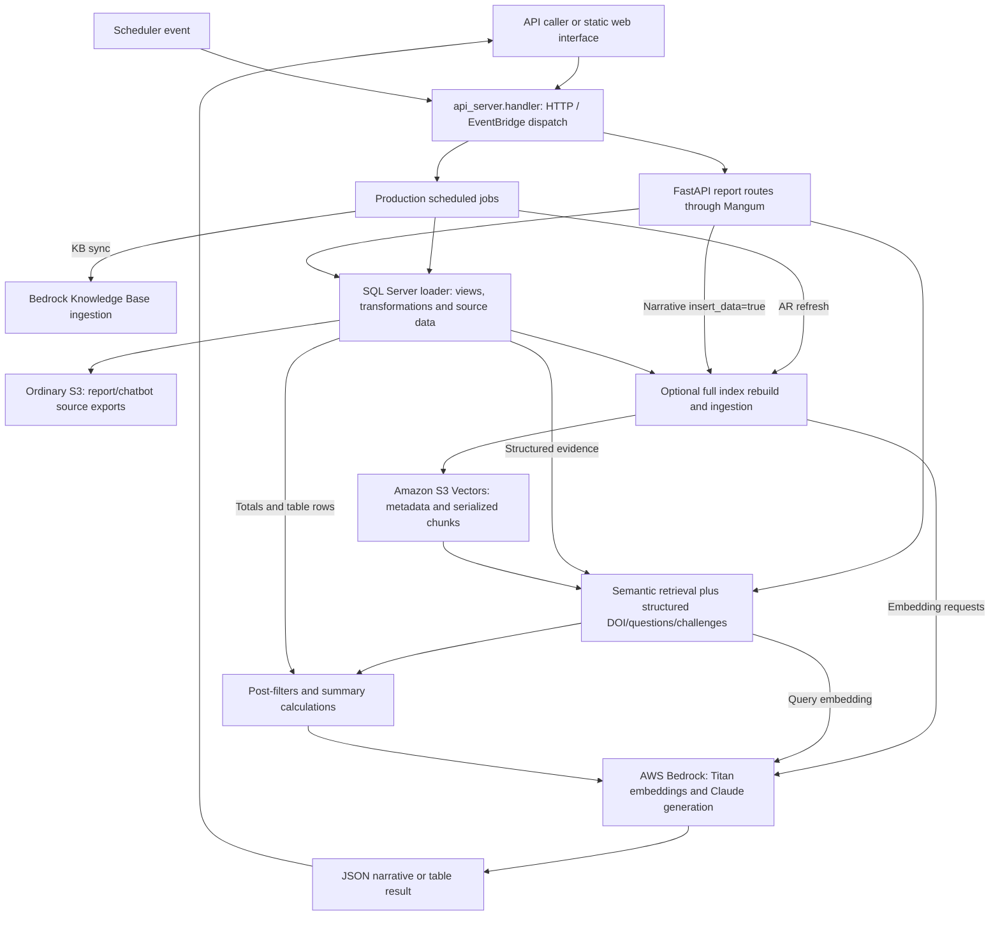

# AICCRA Annual Report Generator Service

The service produces AICCRA mid-year and annual indicator narratives, indicator summary tables, and challenges/lessons-learned reports. Active pipelines combine structured data, Amazon S3 Vectors retrieval, business filters, and AWS Bedrock generation. A static HTML/JavaScript interface supports review and browser-side downloads.

This README describes **`main-ar-generator` and its production SQL Server/Lambda path**. The maintainer uses `dev-ar-generator` for local CSV/MySQL testing without installing pyodbc, and a production Lambda from this branch; a separate test Lambda is not assumed. Preserve the intentional differences using the [branch guide](docs/BRANCH_DIFFERENCES.md).

## Start here

| Goal | Documentation |
| --- | --- |
| Configure the production path or an ODBC-capable local checkout | [Quick start](#quick-start-production-path) |
| Understand report workflows | [Product overview](docs/PRODUCT_OVERVIEW.md) |
| Integrate endpoints and interpret failures | [API guide](docs/API_GUIDE.md) |
| Follow components and retrieval | [Architecture](#system-architecture), [high-level design](docs/HIGH_LEVEL_DESIGN.md) |
| Review SQL/CSV loading, configuration, and operational checks | [Technical guide](docs/TECHNICAL_DOCUMENTATION.md) |
| Work on the UI | [Web README](web/README.md), [web agent guide](web/AGENTS.md) |
| Continue work with an agent | [Service guide](AGENTS.md) |
| Compare development with production | [Branch differences](docs/BRANCH_DIFFERENCES.md) |

## Supported workflows

| Workflow | Entry | Data and effects |
| --- | --- | --- |
| Mid-year narrative | `POST /api/generate` | Contribution totals, semantic/DOI retrieval, business filters, Bedrock narrative |
| Annual narrative | `POST /api/generate-annual` | Totals, retrieved cluster evidence, parallel cluster drafts/editorial passes, optional disaggregation |
| Indicator tables | `POST /api/generate-annual-tables` | Structured contribution data and model-written overviews by group |
| Challenges/lessons | `POST /api/generate-challenges` | Structured challenges rows and model synthesis |
| Index rebuild | `insert_data=true` on narrative endpoints | Delete/recreate the selected index and ingest all configured source tables |
| Review interface | `GET /web` | Serve static UI; generation/analytics destinations are separate JavaScript constants |

The browser UI currently hardcodes the production Lambda as its API base, even when served locally. Use the local API directly until the UI destination has been deliberately reviewed/changed for local work. Its analytics destination is also external and branch-specific; see the [web setup](web/README.md#destinations-and-local-testing).

## Quick start: production path

### 1. Identify the runtime before installing

From the monorepo root:

```bash
cd ar-generator-service
```

The checked-in Dockerfile uses Lambda Python 3.13, unixODBC/Microsoft ODBC Driver 18, and `requirements.txt` including pyodbc. It starts **`api_server.handler`**. This branch has no `pyproject.toml` or `uv.lock`; development's uv/CSV instructions belong to `dev-ar-generator`.

`dev_server.py` is also tracked here as a local Uvicorn helper, but it does not remove SQL Server/ODBC import dependencies and is not the container entry point. Use development for local work that cannot install those native dependencies.

### 2. Review configuration

The [.env.example](.env.example) contains placeholders for this branch's SQL Server/AWS configuration and defaults to `USE_CSV_DATA=false`. It is documentation, not the deployed Lambda environment. Do not overwrite live settings with a copied example.

```env
AWS_ACCESS_KEY_ID_OS=YOUR_AWS_ACCESS_KEY
AWS_SECRET_ACCESS_KEY_OS=YOUR_AWS_SECRET_KEY
AWS_REGION=us-east-1
SERVER=YOUR_SQL_SERVER
DATABASE=YOUR_DATABASE
CLIENT_ID=YOUR_SERVICE_PRINCIPAL_ID
CLIENT_SECRET=YOUR_SERVICE_PRINCIPAL_SECRET
S3_VECTORS_BUCKET_NAME=YOUR_VECTOR_BUCKET
S3_VECTORS_INDEX_NAME=YOUR_VECTOR_INDEX
BUCKET_NAME=YOUR_EXPORT_BUCKET
USE_CSV_DATA=false
```

Bedrock and S3 Vectors use the explicit OS-named AWS key/secret dictionary. The ordinary S3 export client instead uses boto3's standard credential resolution; do not assume the custom OS-named keys configure it. SQL Server uses the configured service principal and ODBC Driver 18. The vector bucket must already exist.

Optional scheduled operations also use `KNOWLEDGE_BASE_ID`, `DATA_SOURCE_ID`, and `SLACK_WEBHOOK_URL`. See [production configuration](docs/TECHNICAL_DOCUMENTATION.md#aws-and-production-configuration) for startup boundaries and side effects.

### 3. Understand the production build

The service directory is the Docker build context:

```bash
docker build -t ar-generator-service .
```

This is a deliberate build command, not a documentation check. The image installs native ODBC dependencies and Python requirements and copies `app/`, `db_conn/`, `web/`, and `api_server.py`. It does not copy the private `.env`, `main.py`, or `dev_server.py` as runtime entry files; `.dockerignore` excludes `.env` and other local artifacts. Production configuration must be supplied by the deployment environment. No image is built or deployed by this documentation update.

### 4. Optional ODBC-capable local diagnostics

Only on a machine with Python 3.13 and compatible native ODBC prerequisites already available:

```bash
python3.13 -m venv .venv
source .venv/bin/activate
python -m pip install -r requirements.txt
python dev_server.py --host 127.0.0.1 --reload
```

Equivalent direct app target is `app.api.main:app`. The helper defaults to port 8000 and enables reload only with `--reload`. Its docstring's `--no-reload` example is stale. Run from this service directory because static assets use relative `web/` paths.

This does not reproduce Lambda/EventBridge dispatch. The route module eagerly imports the SQL loader, which imports pyodbc and S3 export code even when testing with CSVs. A successful local health response does not validate those services.

```bash
curl http://localhost:8000/health
```

Expected response:

```json
{"status":"healthy","service":"AICCRA Report Generator API","version":"1.0.0"}
```

| Local diagnostic resource | URL |
| --- | --- |
| Process metadata | [Root](http://localhost:8000/) |
| Swagger UI | [API docs](http://localhost:8000/docs) |
| ReDoc | [API reference](http://localhost:8000/redoc) |
| Web page | [UI](http://localhost:8000/web) |

### 5. Generate only in the intended environment

On an intentionally configured local diagnostic API:

```bash
curl -X POST http://localhost:8000/api/generate-annual \
  -H 'Content-Type: application/json' \
  -d '{"indicator":"IPI 1.3","year":2025,"insert_data":false}'
```

This can invoke AWS, create/alter SQL views, and export structured data to S3 even with `insert_data:false`. HTTP 200 is not always a usable report: check status/content and [failure semantics](docs/API_GUIDE.md#responses-and-failure-semantics). For pyodbc-free local experiments, use the development branch instead of replacing production imports.

## System architecture



This diagram describes the production branch. HTTP events go through Mangum; scheduler events go through the supported job dispatcher. The source loader can create/alter SQL views and export files to S3. Development's CSV/MySQL path and local cron tools are separate, as recorded in the branch guide.

Active API imports use `app/llm/vectorize.py` and `vectorize_annual.py`, backed by **S3 Vectors**. Development retains alternate OpenSearch/Supabase/Knowledge Base modules that are absent from this production tree; they are not active production rollback switches. See [technical details](docs/TECHNICAL_DOCUMENTATION.md#active-and-retained-modules).

## Technology and models

| Layer | Current implementation |
| --- | --- |
| API/local server | FastAPI, Uvicorn, Python 3.13 |
| Production dependencies | requirements.txt and native ODBC installation in Docker; no tracked lockfile |
| Production source data | SQL Server/Fabric through pyodbc and ODBC Driver 18 |
| Semantic retrieval | boto3 S3 Vectors client; 1,024-dimensional cosine index |
| Embeddings | `amazon.titan-embed-text-v2:0` |
| Active generation | `us.anthropic.claude-sonnet-4-5-20250929-v1:0`, temperature 0.1, max tokens 8000 |
| Browser UI | Static HTML/CSS/JavaScript, browser DOCX and CSV exports |
| Production path | SQL Server/pyodbc/ODBC 18, Lambda container, HTTP/EventBridge dispatch |

The generation client consumes a Bedrock response stream internally and returns accumulated text. The public report endpoints return complete JSON responses, not token streams or background job IDs. Older Swagger/root descriptions mentioning OpenSearch, Claude 3.7, or older year limits do not describe the current active pipeline.

## Configuration

The maintained production-path example is [.env.example](.env.example). Configure actual deployment settings independently and review which credential source each client consumes.

| Setting | Purpose |
| --- | --- |
| `AWS_ACCESS_KEY_ID_OS`, `AWS_SECRET_ACCESS_KEY_OS` | Active shared AWS key/secret configuration |
| `AWS_REGION` | Region used by active Bedrock, S3 Vectors, and export clients; default `us-east-1` |
| `S3_VECTORS_BUCKET_NAME`, `S3_VECTORS_INDEX_NAME` | Existing vector bucket and selected index; the code does not create a vector bucket |
| `USE_CSV_DATA` | Optional CSV override in load_data; default false. It does not remove pyodbc/S3 import dependencies and does not switch load_full_data to CSV. |
| `CSV_DATA_DIR` | Optional prepared-CSV directory; default resolves to `app/` |
| `BUCKET_NAME` | Ordinary S3 exports used by ancillary/production data paths |
| `SERVER`, `DATABASE`, `CLIENT_ID`, `CLIENT_SECRET` | Active SQL Server/Fabric service-principal connection configuration |
| `KNOWLEDGE_BASE_ID`, `DATA_SOURCE_ID` | Ancillary KB synchronization settings |
| `SLACK_WEBHOOK_URL` | Optional notification destination in job/cron utilities |

Use separate development resources for local experiments. The request's year/indicator and `USE_CSV_DATA` do not select an isolated vector index, change the UI's hardcoded production URL, or create a test Lambda.

## Retrieval and refresh behavior

| Query | Current path |
| --- | --- |
| Semantic indicator/year/table context | Titan query embedding and S3 Vectors metadata filtering |
| Mid-year DOI evidence | Structured deliverables rows merged with semantic chunks, deduplicated by DOI/cluster/indicator |
| Annual questions/disaggregation | Structured question/contribution rows and Python filters |
| Challenges | Structured challenges rows; current helper does not apply a year filter |
| Shared/cancelled/AWPB/Progress rules | Python `post_filters.py`; behavior depends on correct table labels/fields |

`insert_data=true` on a narrative request **deletes and recreates the configured index**, then re-embeds all selected source tables. It is not a year-only refresh. Mid-year ingests five tables; annual adds challenges as a sixth. Both use the same configured index, so the two rebuild paths are not independent stores. Missing rows/embedding failures may be skipped; successful completion logs alone do not establish a complete populated index.

Tables and challenges reuse `ChatRequest` but only consume its year; their route implementations do not forward `insert_data`. Keep the flag false in routine generation examples. Index provisioning/rebuilds, real model checks, and data exports need deliberate operational scope.

## Project structure

```text
ar-generator-service/
├── README.md, AGENTS.md       # Production entry point and working rules
├── Dockerfile, .dockerignore # ODBC-enabled Lambda packaging
├── requirements.txt          # Python dependencies installed by Docker
├── api_server.py             # Packaged HTTP/EventBridge handler
├── dev_server.py             # Auxiliary local Uvicorn launcher
├── main.py                   # Simple adapter; not Docker's handler
├── .env.example              # Production-path placeholders, no real secrets
├── docs/                     # API, design, data/operations and branch guides
├── app/
│   ├── api/                  # Routes/models, static mounting, eager SQL import
│   ├── llm/                  # Active report pipelines and Bedrock invocation
│   ├── s3_vectors/           # Vector client, ingestion, metadata
│   ├── retrieval/            # Semantic/structured retrieval and filters
│   └── utils/
│       ├── jobs/             # Production scheduled-job dispatcher
│       ├── s3/               # Source exports and chatbot-file splitting
│       └── ...               # Prompts, configuration, logs, notifications
├── db_conn/sql_connection.py # Active SQL Server loader and exports
├── tests/                    # Shared filter/schema assertions
└── web/                      # Static interface; production analytics destination
```

Development-only MySQL/CSV plumbing, alternate backends, cron utilities, Streamlit/lakehouse tools, pyproject and lockfile are not present in this production tree. The [initial branch inventory](docs/BRANCH_DIFFERENCES.md#initial-file-inventory) records the intentional differences before documentation integration.

## Branch and deployment workflow

```text
task branch from dev-ar-generator
    → dev-ar-generator → main-ar-generator → staging → main
```

Do not make the service trees identical by replacing production's SQL Server loader with local CSV/MySQL plumbing. Production's Docker command targets **`api_server.handler`**, which routes HTTP to Mangum and supported scheduler events to job functions. The tracked `main.handler` adapter also does not implement that dispatcher and is not selected by this Dockerfile.

The production-branch workflow targets pushes/PRs to `main-ar-generator` and manual dispatch, invoking the production Lambda Jenkins job. That workflow is present in this production branch and has no documentation path exclusion. Its file does not establish external triggers or live pipeline status. The maintainer supervises release merges and pushes; after the local service-main merge, compare all files and adapt production docs before push. Completed service updates accumulate in staging for the agreed consolidated PR to main.

## Scheduled operations

The packaged handler distinguishes job-only events from HTTP-shaped events. An example scheduler body is:

```json
{"job":"sync_knowledge_base"}
```

This is a Lambda-event interface, not a public POST endpoint or a safe health probe. Supported job names are:

| Job | Current implementation |
| --- | --- |
| update_ar_data | Calls annual pipeline with fixed IPI 1.3/year 2025/insert_data:true |
| update_chatbot_data | Loads/exports five source tables and generates per-record chatbot files |
| sync_knowledge_base | Starts Bedrock KB ingestion; a started job is not confirmed completion |

Jobs can send Slack notifications. No scheduler installation, deployed schedule, real job, source export, or KB ingestion is performed by documentation checks. See [operations](docs/TECHNICAL_DOCUMENTATION.md#scheduled-operations) before deliberate execution.

## Validation and troubleshooting

The six existing checks in `tests/test_retrieval.py` and `tests/test_vector_store_schemas.py` target filtering/metadata functions. Normal collection also imports `app.s3_vectors.__init__`, which eagerly loads ingestion/data/provider dependencies. They are not isolated from application initialization by default.

For documentation checks, use the [offline unit bootstrap](docs/TECHNICAL_DOCUMENTATION.md#offline-unit-checks), which loads the actual schema/filter modules while bypassing package initialization and blocking network. Pytest is not included in this branch's requirements; use a suitable test environment. Do not treat a successful isolated run as a live SQL/AWS/Lambda check. Streamlit, host-cron and lakehouse diagnostic tools belong to the development branch and are absent here; production jobs/ingestion helpers can modify resources and are not unit-test entry points.

| Symptom | Check |
| --- | --- |
| pyodbc/ODBC installation blocks local setup | Production intentionally needs the native stack provided by its Dockerfile. For pyodbc-free local work use dev-ar-generator; do not remove production imports to match a local machine. |
| `GET /health` works but generation fails | Health does not query sources/providers. Check OS-named Bedrock/vector keys, the separate S3 credential source, SQL service principal/views, data, and logs. |
| CSV is missing or totals are empty | Verify `CSV_DATA_DIR`, filenames, prepared column names/types, and the requested indicator/year. Loader errors can become empty DataFrames. |
| UI served locally still uses production | Inspect `API_BASE_URL` and `AI_FEEDBACK_URL` in `web/app.js`; they are fixed constants, not inferred from the page URL. |
| Wrong AWS credentials despite editing `*_BR` | The active config reads `*_OS`. Restart after changing configuration. |
| S3 Vectors SDK/permission/query failure | Check installed SDK support, the selected resource/account, request settings, and IAM access. Do not rebuild production merely to diagnose retrieval. |
| Report is empty or weak | Inspect data, retrieval logs and error/status content. Missing context can result from swallowed data/provider errors; a rebuild is not automatically the remedy. |
| Generated context files appear in a production checkout | Explicit context-save calls are absent from active production pipelines. Check the executed branch/path and preserve that separation from development. |
| A scheduled operation fails or appears incomplete | Inspect its Lambda response, job status, logs and target resources. A timeout or started KB ingestion is not a completed durable job. |

This branch logs under `/tmp/logs/app.log` (5 MiB, five backups, DEBUG logger `ar-generator-service`), plus stdout. Development uses a service-relative directory and different logger name. Generated context files, CSV exports, and logs may contain real reporting data; do not commit them.

The repository [LICENSE](../LICENSE) contains Apache 2.0, while API metadata labels MIT. This documentation records that existing mismatch without changing licensing metadata or runtime behavior.
