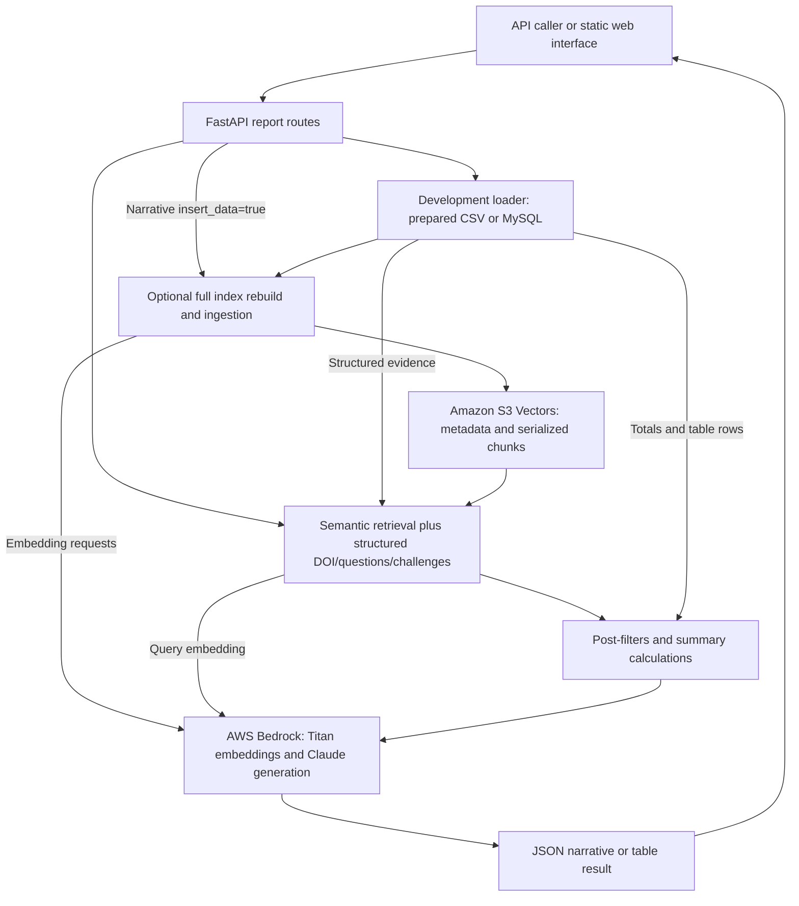

# AICCRA Annual Report Generator Service

The service produces AICCRA mid-year and annual indicator narratives, indicator summary tables, and challenges/lessons-learned reports. Active pipelines combine structured data, Amazon S3 Vectors retrieval, business filters, and AWS Bedrock generation. A static HTML/JavaScript interface supports review and browser-side downloads.

This README describes **`dev-ar-generator` and its local CSV/MySQL execution path**. The maintainer uses local testing for development and a production Lambda from `main-ar-generator`; a separate test Lambda is not assumed. Production has different data loading, dependencies, entry points, jobs, logging, and packaging. Preserve those differences using the [branch guide](docs/BRANCH_DIFFERENCES.md).

## Start here

| Goal | Documentation |
| --- | --- |
| Run locally without pyodbc/SQL Server | [Quick start](#quick-start-local-csv-path) |
| Understand report workflows | [Product overview](docs/PRODUCT_OVERVIEW.md) |
| Integrate endpoints and interpret failures | [API guide](docs/API_GUIDE.md) |
| Follow components and retrieval | [Architecture](#system-architecture), [high-level design](docs/HIGH_LEVEL_DESIGN.md) |
| Prepare CSVs, configuration, and operational checks | [Technical guide](docs/TECHNICAL_DOCUMENTATION.md) |
| Work on the UI | [Web README](web/README.md), [web agent guide](web/AGENTS.md) |
| Continue work with an agent | [Service guide](AGENTS.md) |
| Compare development with production | [Branch differences](docs/BRANCH_DIFFERENCES.md) |

## Supported workflows

| Workflow | Entry | Data and effects |
| --- | --- | --- |
| Mid-year narrative | `POST /api/generate` | Contribution totals, semantic/DOI retrieval, business filters, Bedrock narrative |
| Annual narrative | `POST /api/generate-annual` | Totals, retrieved cluster evidence, parallel cluster drafts/editorial passes, optional disaggregation |
| Indicator tables | `POST /api/generate-annual-tables` | Structured contribution data and model-written overviews by group |
| Challenges/lessons | `POST /api/generate-challenges` | Structured challenges rows and model synthesis |
| Index rebuild | `insert_data=true` on narrative endpoints | Delete/recreate the selected index and ingest all configured source tables |
| Local review interface | `GET /web` | Serve static UI; generation/analytics destinations are separate JavaScript constants |

The browser UI currently hardcodes the production Lambda as its API base, even when served locally. Use the local API directly until the UI destination has been deliberately reviewed/changed for local work. Its analytics destination is also external and branch-specific; see the [web setup](web/README.md#destinations-and-local-testing).

## Quick start: local CSV path

### 1. Install the development environment

From the monorepo root, use Python 3.13 and uv:

### Local

```bash
cd ar-generator-service
uv sync --frozen --python 3.13
```

Development uses `pyproject.toml` and `uv.lock`; it has no service-root `requirements.txt` or Dockerfile. The separate `lakehouse_integration/Dockerfile` is an ODBC diagnostic container, not the report API image. Production uses its own Dockerfile and requirements, described in the branch guide.

### 2. Configure local data and isolated AWS resources

```bash
cp .env.example .env
```

Edit the copied file with credentials and a vector bucket/index intended for development. The example defaults to CSV data and uses placeholders; do not point a rebuild at an index that must be retained.

```env
USE_CSV_DATA=true
AWS_REGION=us-east-1
AWS_ACCESS_KEY_ID_OS=YOUR_DEVELOPMENT_ACCESS_KEY
AWS_SECRET_ACCESS_KEY_OS=YOUR_DEVELOPMENT_SECRET_KEY
S3_VECTORS_BUCKET_NAME=YOUR_DEVELOPMENT_VECTOR_BUCKET
S3_VECTORS_INDEX_NAME=YOUR_DEVELOPMENT_VECTOR_INDEX
```

The active AWS dictionary reads `AWS_ACCESS_KEY_ID_OS` / `AWS_SECRET_ACCESS_KEY_OS`, not the older `*_BR` aliases. Bedrock initialization explicitly requires both values. S3 Vectors uses the same explicit key/secret and configured region. No model call or live credential check is established by this documentation.

`USE_CSV_DATA=true` avoids MySQL/SQL Server connections in the active development loader. It does **not** make generation offline: model calls, semantic queries, and optional index writes still use AWS. Keep credentials and actual reporting CSVs out of Git.

### 3. Supply prepared CSV fixtures

By default, CSV lookup is under **`ar-generator-service/app/`**, based on the current config's calculated path. Set `CSV_DATA_DIR` to another prepared directory if needed.

| Source | Fixture filename |
| --- | --- |
| Contributions | `vw_ai_project_contribution_ar.csv` |
| Questions | `vw_ai_questions_ar.csv` |
| Deliverables | `vw_ai_deliverables_ar.csv` |
| OICRs | `vw_ai_oicrs_ar.csv` |
| Innovations | `vw_ai_innovations_ar.csv` |
| Challenges | `vw_ai_challenges_ar.csv` |

CSV mode reads these as already-processed tables and returns them without the MySQL transformation step. They need the fields consumed by totals, filters, and prompts, including appropriate `table_type` labels. They are not arbitrary raw exports. See [CSV preparation](docs/TECHNICAL_DOCUMENTATION.md#csv-inputs-and-data-loading).

### 4. Run and check process health

```bash
uv run --frozen python dev_server.py --host 127.0.0.1 --reload
```

The server defaults to port 8000; reload is enabled only with `--reload`. The launcher's docstring mentions `--no-reload`, but that option is not implemented. Direct Uvicorn is another local path:

```bash
uv run --frozen python -m uvicorn app.api.main:app --host 127.0.0.1 --port 8000 --reload
```

In another terminal:

```bash
curl http://localhost:8000/health
```

Expected response:

```json
{"status":"healthy","service":"AICCRA Report Generator API","version":"1.0.0"}
```

Health does not test AWS, source data, model access, or a populated index. Report pipelines are lazily imported. Run from the service directory because static assets use relative `web/` paths.

| Local resource | URL |
| --- | --- |
| Process metadata | [Root](http://localhost:8000/) |
| Swagger UI | [API docs](http://localhost:8000/docs) |
| ReDoc | [API reference](http://localhost:8000/redoc) |
| Web page | [UI](http://localhost:8000/web) |

### 5. Generate deliberately against the local API

With a suitable existing development index and prepared source data:

```bash
curl -X POST http://localhost:8000/api/generate-annual \
  -H 'Content-Type: application/json' \
  -d '{"indicator":"IPI 1.3","year":2025,"insert_data":false}'
```

This invokes configured providers and may incur charges. HTTP 200 does not always mean a usable report: check `status` and `content` as described in the [API guide](docs/API_GUIDE.md#responses-and-failure-semantics).

## System architecture



This diagram describes development's active CSV/MySQL path. Production uses SQL Server/Fabric through `db_conn/sql_connection.py`, a hybrid HTTP/EventBridge Lambda handler, and production packaging. Its loader can create/alter SQL views and export files to S3. A local CSV run is not a validation of those production effects.

Active API imports use `app/llm/vectorize.py` and `vectorize_annual.py`, backed by **S3 Vectors**. The retained OpenSearch, Supabase, and Knowledge Base modules are alternatives/reference code with unresolved imports/configuration assumptions; they are not verified drop-in rollback paths. See [technical details](docs/TECHNICAL_DOCUMENTATION.md#active-and-retained-modules).

## Technology and models

| Layer | Current implementation |
| --- | --- |
| API/local server | FastAPI, Uvicorn, Python 3.13 |
| Development dependency management | uv, pyproject, lockfile |
| Development source data | CSV fixtures or SQLAlchemy/MySQL connector |
| Semantic retrieval | boto3 S3 Vectors client; 1,024-dimensional cosine index |
| Embeddings | `amazon.titan-embed-text-v2:0` |
| Active generation | `us.anthropic.claude-sonnet-4-5-20250929-v1:0`, temperature 0.1, max tokens 8000 |
| Browser UI | Static HTML/CSS/JavaScript, browser DOCX and CSV exports |
| Production path | SQL Server/pyodbc/ODBC 18, Lambda container, HTTP/EventBridge dispatch |

The generation client consumes a Bedrock response stream internally and returns accumulated text. The public report endpoints return complete JSON responses, not token streams or background job IDs. Older Swagger/root descriptions mentioning OpenSearch, Claude 3.7, or older year limits do not describe the current active pipeline.

## Configuration

The maintained local template is [.env.example](.env.example). Configure only the integrations needed for the chosen path.

| Setting | Purpose |
| --- | --- |
| `AWS_ACCESS_KEY_ID_OS`, `AWS_SECRET_ACCESS_KEY_OS` | Active shared AWS key/secret configuration |
| `AWS_REGION` | Region used by active Bedrock, S3 Vectors, and export clients; default `us-east-1` |
| `S3_VECTORS_BUCKET_NAME`, `S3_VECTORS_INDEX_NAME` | Existing vector bucket and selected index; the code does not create a vector bucket |
| `USE_CSV_DATA` | Development loader selector; true/1/yes enables CSV; code default is false |
| `CSV_DATA_DIR` | Prepared CSV directory; default resolves to `app/` |
| `MYSQL_DATABASE_URL` | Used by development when CSV mode is disabled |
| `BUCKET_NAME` | Ordinary S3 exports used by ancillary/production data paths |
| `SERVER`, `DATABASE`, `CLIENT_ID`, `CLIENT_SECRET` | SQL Server/Fabric configuration for the production/diagnostic path |
| `KNOWLEDGE_BASE_ID`, `DATA_SOURCE_ID` | Ancillary KB synchronization settings |
| `SUPABASE_URL`, `COLLECTION_NAME` | Retained Supabase configuration; not the active API pipeline |
| `SLACK_WEBHOOK_URL` | Optional notification destination in job/cron utilities |

Use separate development resources for local experiments. The request's year/indicator and `USE_CSV_DATA` do not select an isolated vector index, change the UI's hardcoded production URL, or create a test Lambda.

## Retrieval and refresh behavior

| Query | Current path |
| --- | --- |
| Semantic indicator/year/table context | Titan query embedding and S3 Vectors metadata filtering |
| Mid-year DOI evidence | Structured deliverables rows merged with semantic chunks, deduplicated by DOI/cluster/indicator |
| Annual questions/disaggregation | Structured question/contribution rows and Python filters |
| Challenges | Structured challenges rows; current helper does not apply a year filter |
| Shared/cancelled/AWPB/Progress rules | Python `post_filters.py`; behavior depends on correct table labels/fields |

`insert_data=true` on a narrative request **deletes and recreates the configured index**, then re-embeds all selected source tables. It is not a year-only refresh. Mid-year ingests five tables; annual adds challenges as a sixth. Both use the same configured index, so the two rebuild paths are not independent stores. Missing rows/embedding failures may be skipped; successful completion logs alone do not establish a complete populated index.

Tables and challenges reuse `ChatRequest` but only consume its year; their route implementations do not forward `insert_data`. Keep the flag false in routine generation examples. Index provisioning/rebuilds, real model checks, and data exports need deliberate operational scope.

## Project structure

```text
ar-generator-service/
├── README.md, AGENTS.md       # Service entry point and continuation rules
├── dev_server.py             # Local Uvicorn launcher
├── main.py                   # Simple Mangum adapter in development
├── pyproject.toml, uv.lock   # Development dependencies
├── .env.example              # Local setup template; actual .env is private
├── docs/                     # Product, design, API, operations, branch comparison
├── app/
│   ├── api/                  # Routes, request/response models, static mounting
│   ├── llm/
│   │   ├── vectorize.py, vectorize_annual.py  # Active report pipelines
│   │   ├── invoke_llm.py      # Bedrock embeddings and generation
│   │   ├── opensearch/, supabase/ # Retained alternatives
│   │   └── knowledge_base.py # Separate reference integration
│   ├── s3_vectors/           # Client, metadata schema, index ingestion
│   ├── retrieval/            # Semantic and structured retrieval, filters
│   ├── utils/                # Prompts, config, logs, exports, notifications, cron
│   └── vw_ai_*_ar.csv         # Local fixtures, untracked
├── db_conn/mysql_connection.py # Development CSV/MySQL loader
├── tests/                    # Pure unit tests and separate Streamlit tool
├── web/                      # Static review interface and its own guide
└── lakehouse_integration/    # Separate ODBC diagnostic container
```

Production additionally has its own Dockerfile, requirements, `api_server.py`, SQL Server loader/export helper, and job dispatcher. Its pre-existing design/product/technical documents must be reconciled with the development guides added here. The [complete branch inventory](docs/BRANCH_DIFFERENCES.md#initial-file-inventory) identifies files to retain or adapt during integration.

## Branch and deployment workflow

```text
task branch from dev-ar-generator
    → dev-ar-generator → main-ar-generator → staging → main
```

Do not make the service trees identical by replacing production's SQL Server loader with local CSV/MySQL plumbing. Production's Docker command targets **`api_server.handler`**, which routes HTTP to Mangum and supported scheduler events to job functions. Development's `main.handler` does not implement that dispatcher.

The production-branch workflow targets pushes/PRs to `main-ar-generator` and manual dispatch, invoking the production Lambda Jenkins job. That workflow is absent from this development snapshot. This does not establish external triggers or live pipeline status. The maintainer supervises release merges and pushes; after the local service-main merge, compare all files and adapt production docs before push. Completed service updates accumulate in staging for the agreed consolidated PR to main.

## Validation and troubleshooting

The six existing checks in `tests/test_retrieval.py` and `tests/test_vector_store_schemas.py` target filtering/metadata functions. Normal collection also imports `app.s3_vectors.__init__`, which eagerly loads ingestion/data/provider dependencies. They are not isolated from application initialization by default.

For documentation checks, use the [offline unit bootstrap](docs/TECHNICAL_DOCUMENTATION.md#offline-unit-checks), which loads the actual schema/filter modules while bypassing package initialization and blocking network. Pytest is not declared in the development project dependencies; use a suitable test environment. Do not treat a successful isolated run as a live SQL/AWS/Lambda check. `tests/streamlit/generator.py`, cron scripts, ingestion helpers, and the lakehouse diagnostic are separate tools that may invoke providers, modify resources, or expose data in output.

| Symptom | Check |
| --- | --- |
| pyodbc/ODBC installation blocks local setup | Use this development branch's uv environment and CSV loader; the active local path does not require pyodbc. Production's container provides ODBC separately. |
| `GET /health` works but generation fails | Pipelines import lazily. Check active `*_OS` credentials, data columns, vector configuration, model access, and logs. |
| CSV is missing or totals are empty | Verify `CSV_DATA_DIR`, filenames, prepared column names/types, and the requested indicator/year. Loader errors can become empty DataFrames. |
| UI served locally still uses production | Inspect `API_BASE_URL` and `AI_FEEDBACK_URL` in `web/app.js`; they are fixed constants, not inferred from the page URL. |
| Wrong AWS credentials despite editing `*_BR` | The active config reads `*_OS`. Restart after changing configuration. |
| S3 Vectors SDK/permission/query failure | Check installed SDK support, the selected resource/account, request settings, and IAM access. Do not rebuild production merely to diagnose retrieval. |
| Report is empty or weak | Inspect data, retrieval logs and error/status content. Missing context can result from swallowed data/provider errors; a rebuild is not automatically the remedy. |
| Generated context files appear locally | Development writes `context_<indicator>_<year>.json` in the current directory. Treat contents as reporting evidence and keep them untracked. |
| Crons report success after timeout | Some retained scripts interpret timeouts as accepted work. This is not evidence of a completed background job or durable processing. |

Development logs rotate under `data/logs/app.log` (5 MiB, five backups, DEBUG logger). Production uses `/tmp/logs/app.log` and a different logger name. Generated context files, CSV exports, and logs may contain real reporting data; do not commit them.

The repository [LICENSE](../LICENSE) contains Apache 2.0, while API metadata labels MIT. This documentation records that existing mismatch without changing licensing metadata or runtime behavior.
