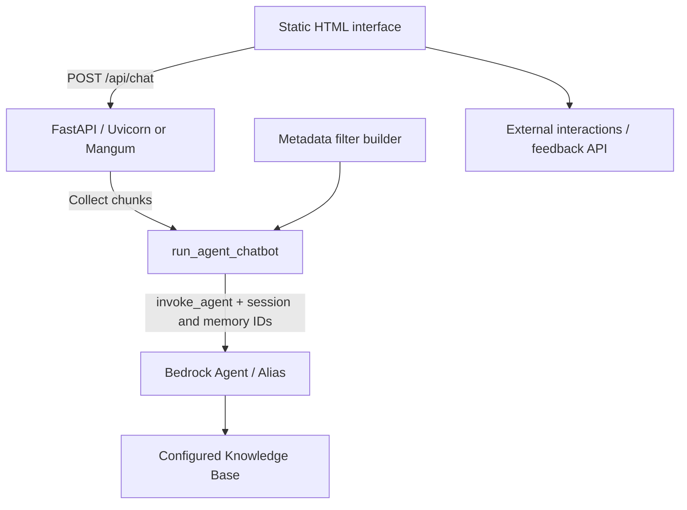

# AICCRA AI Chatbot Service

Conversational access to AICCRA reporting data using Amazon Bedrock Agents and a configured Knowledge Base. Users can explore deliverables, contributions, innovations and Outcome Impact Case Reports (OICRs), with reporting-phase, indicator and section filters.

This guide describes **`main-chatbot-service`**: the FastAPI backend, static browser interface and Lambda container packaging. This branch has no Streamlit entry point, SQL loader, conversion scripts or direct OpenSearch/model clients. See the [development comparison](docs/BRANCH_DIFFERENCES.md) for intentional branch differences.

## Documentation

| Need | Guide |
| --- | --- |
| Install and run | This README |
| Integrate HTTP chat | [API contract](docs/API.md) |
| Maintain backend modules | [Technical documentation](TECHNICAL_DOCUMENTATION.md) |
| Understand system boundaries | [System architecture](docs/HIGH_LEVEL_SOFTWARE_DESIGN.md) |
| Understand users and limitations | [Product overview](docs/PRODUCT_OVERVIEW.md) |
| Maintain the HTML interface | [Interface guide](interface/README.md) |
| Continue as an agent | [Service instructions](AGENTS.md) |

## Quick start

Use Python 3.13 to match the Lambda base image. Run from `chatbot-service/`: static serving expects the `interface/` directory in the working directory.

```bash
cd chatbot-service
python3.13 -m venv .venv
.venv/bin/python -m pip install -r requirements.txt
cp .env.example .env
# Fill in the chat configuration below before sending a message.
.venv/bin/python api_server.py --host 127.0.0.1 --port 8000 --reload
```

Open `http://localhost:8000/chatbot-ui` for browser chat, `/docs` for OpenAPI or `/health` for HTTP availability. Health returns static capability labels; it does **not** probe AWS, ingestion or database connectivity. Some generated API descriptions still promise an inactive data-reload path; the [API guide](docs/API.md) describes the implementation.

The HTML page calls the fixed Lambda endpoint `https://lvurhov4wryn4pygqxf6tp54uq0jdpgs.lambda-url.us-east-1.on.aws/api/chat`, even when opened at localhost. It also sends interaction/feedback records to a separate remote service. Opening `/chatbot-ui` therefore does not test the local chat backend. Use the local curl/Python examples below to test it. Pointing the page at a local API would require an explicit change to its JavaScript constant; `.env` does not override it. See the [interface guide](interface/README.md).

The Dockerfile and local setup both install `requirements.txt`. This branch has no `pyproject.toml` or `uv.lock`; requirements are unpinned, so installation is not reproducible from a lockfile. The presence of Streamlit or OpenAI packages in requirements does not establish a runnable interface or client for them here.

### First API request

This invokes the configured AWS agent and can incur provider charges. Use fictional identifiers for testing; reuse a session ID for follow-up questions.

```bash
curl -X POST http://localhost:8000/api/chat \
  -H 'Content-Type: application/json' \
  -d '{
    "message": "What deliverables relate to climate information services?",
    "phase": "AR 2025",
    "indicator": "All indicators",
    "section": "Deliverables",
    "session_id": "baf542c1-e699-4b4e-9a61-1fe4794aa044",
    "memory_id": "demo-user",
    "insert_data": false
  }'
```

The API joins agent chunks into one JSON response; it does not stream HTTP tokens.

## Configuration

Copy [.env.example](.env.example) and populate the integrations you use. Never commit `.env` or credentials. [config_util.py](app/utils/config/config_util.py) loads these names through `python-dotenv`.

| Variables | Consumer / requirement |
| --- | --- |
| `AWS_REGION` | AWS client region |
| AWS credentials | Standard SDK credential chain: deployment role or a configured local profile/environment; clients do not pass access/secret keys explicitly |
| `AGENT_ID`, `AGENT_ALIAS_ID`, `KNOWLEDGE_BASE_ID` | Existing agent, alias and retrieval configuration for chat |
| `BUCKET_NAME` | Optional auxiliary S3 uploads; not a direct dependency of normal chat |
| `AI_FEEDBACK_URL` | Read into config but not used by the active backend; HTML uses a fixed constant |
| `MEMORY_ID` | Read into config but not used for active chat identity; callers supply `memory_id` |
| SQL/OpenSearch settings in config | Residual configuration dictionaries; their local implementations are absent from this branch |

The agent model, instructions, Knowledge Base ingestion, memory enablement and retention are AWS-side settings. Historical model names in generated API descriptions do not establish which model the agent alias uses. Configure resources and outbound AWS permissions separately; these do not establish inbound HTTP authentication.

## System architecture



The active request uses `app/llm/agents.py`. It does not execute SQL, populate OpenSearch, upload documents or start Knowledge Base ingestion. Those resources and ingestion are managed outside this request path; their development scripts are not present here. See the [architecture guide](docs/HIGH_LEVEL_SOFTWARE_DESIGN.md).

| Component | Implemented behavior |
| --- | --- |
| FastAPI | Validates input, forwards filters/identifiers, joins agent chunks and returns JSON |
| HTML | Calls HTTP chat, manages local messages/filter controls, sends remote interactions/feedback |
| Bedrock agent | External orchestration, retrieval and generated answer; deployment controls model/memory |

Answers may contain omissions or unsupported statements. Review citations and source records before official reporting. This repository establishes no response-time guarantee or data refresh schedule.

## Questions and reporting filters

Examples depend on indexed source data and agent configuration:

- Progress: “What progress has been made on IPI 1.1 in 2025?” or “How are clusters performing against targets?”
- Deliverables: “What publications were released by the Kenya cluster?” or “Show research outputs related to climate information services.”
- Innovations: “What innovations support climate-smart agriculture?” or “What readiness levels have been reported?”
- Outcomes: “Show outcome case reports from Western Africa.” or “What evidence describes farmer livelihood impacts?”

| Control | Meaning |
| --- | --- |
| Phase | UI choices include AWPB, Progress and AR for 2021–2025; HTTP field remains `phase`, e.g. `AR 2025` |
| Indicator | Literal acronym such as `IPI 1.1` or `PDO Indicator 3`; UI options depend on year |
| Section | `Deliverables`, `Contributions`, `Innovations`, `OICRs`, or `All sections` |

AWPB means Annual Work Plan and Budget; Progress is the progress-report phase; AR means Annual Report. Deliverables cover outputs such as publications/tools/datasets, Contributions cover reporting narratives/questions, Innovations cover technology/practice records, and OICRs describe outcome impact cases.

The API accepts strings rather than catalog enums. Use exact `All phases`, `All indicators` and `All sections` sentinels. Retrieval requests 30 HYBRID results. Contributions include both `contributions` and `questions` metadata. Phase name is applied only for Contributions; year applies to other sections too. See [filter details and null limitations](docs/API.md).

## Sessions, access and feedback

The API forwards caller-supplied `session_id` and `memory_id` to Bedrock. The HTML interface derives memory identity from the part of an entered or URL-provided email before `@`; email and ownership are not verified. Equal local parts from different domains can select the same memory ID. Starting a session changes the session ID and clears local history; it does not delete provider memory. The agent always sends `endSession=false`.

Python HTTP routes have no authentication dependency. CORS permits all origins and credentials. AWS IAM credentials authorize outbound calls; gateway controls must be checked separately. Email entry and CORS do not provide user authorization.

The HTML interface sends feedback to external `/api/interactions`. There is no local `/api/feedback` route. The unused `feedback_util.py` imports `FeedbackRequest` and `FeedbackResponse` classes absent from current models; it is not a supported alternative implementation.

## Project structure

```text
chatbot-service/
├── README.md / AGENTS.md           # Onboarding and service working rules
├── TECHNICAL_DOCUMENTATION.md      # Backend maintenance map
├── docs/                          # Contract, architecture, product, branch differences
├── api_server.py                   # Local Uvicorn launcher
├── main.py                         # Mangum Lambda handler
├── interface/                      # Static HTML UI and guides
├── app/api/                        # FastAPI app, route and Pydantic models
├── app/llm/agents.py                # Active Bedrock Agent generator
├── app/utils/agents_utils/          # Metadata filter construction
├── app/utils/config/               # Environment loading
├── app/utils/logger/               # Console + rotating local logs
├── app/utils/prompts/              # Retained templates, not loaded by active agent
├── app/utils/s3/                   # Auxiliary export/upload helpers
├── app/utils/feedback/             # Inactive helper; missing model imports
├── Dockerfile                     # Lambda Python 3.13 image
└── requirements.txt               # Actual Docker/local install input
```

## Python integration example

```python
import requests

response = requests.post(
    "http://localhost:8000/api/chat",
    json={
        "message": "Summarize deliverables for AR 2025",
        "phase": "AR 2025",
        "section": "Deliverables",
        "session_id": "baf542c1-e699-4b4e-9a61-1fe4794aa044",
        "memory_id": "demo-user",
        "insert_data": False,
    },
    timeout=120,
)
response.raise_for_status()
print(response.json()["message"])
```

The timeout is a caller choice. Provider failures can become ordinary answer text with HTTP 200; see the [error contract](docs/API.md).

## Development and validation

Update models, routes, the HTML interface and examples together for contract changes. Coordinate metadata changes with retrieval filters and ingestion. `agents.py` sends both textual filters and actual retrieval configuration. Editing local prompt templates does not update externally configured agent instructions.

Logs go to console and `/tmp/logs/app.log`, rotating at 5 MiB with five backups. Routes log message prefixes/identity, and the agent prints questions/answers and logs retrieval configuration. Keep reporting data, logs, generated exports and credentials out of commits.

No dedicated service test suite is tracked here. Check documentation links, example syntax, model validation, filter construction and fake-agent API responses offline. Review imports before running retained helpers: S3 utilities can upload data and construct AWS clients at import. The inactive feedback helper has missing model imports. See the [maintenance guide](TECHNICAL_DOCUMENTATION.md) for offline check boundaries.

## Troubleshooting

| Symptom | Check |
| --- | --- |
| Installation fails | Use Python 3.13 and this branch's requirements; verify package/network compatibility without substituting a development lockfile |
| Health succeeds but chat fails | Health is static; check region, agent/alias/KB IDs and AWS credentials/permissions |
| UI calls an unexpected server | HTML constants are independent of `.env` |
| Missing/broad results | Check metadata values/types, section mapping, HYBRID support and external ingestion |
| Reload reports success but data stays old | The agent does not implement reload; response flags/timings do not prove ingestion |
| Null section fails with a selected phase | Builder may call `.lower()` on `None`; send a string such as `All sections` |
| Feedback fails | Check separate interaction service URL, response and CORS |
| Development tool is missing | Streamlit entry point, SQL loader, converters and direct model clients are absent here; use development for that work |
| Static directory missing | Start from `chatbot-service/`, where `interface/` exists |
| Context/timeout answer | Narrow the question or start a new session; some provider errors become friendly text |

## Deployment and promotion

`main.py` exports `main.handler = Mangum(app)`. The checked-in Dockerfile uses `public.ecr.aws/lambda/python:3.13`, installs `requirements.txt` and sets `CMD ["main.handler"]`. It explicitly copies `.env` and then the full service context; a build requires that file. Keep real credentials out of image contents and review the build context before packaging. This documentation update does not change that Docker behavior.

Prepare tasks from `dev-chatbot-service`, then promote through `dev-chatbot-service → main-chatbot-service → staging → main`. The workflow `.github/workflows/jenkins-trigger-chatbot-service-prod.yml` triggers Jenkins on pushes/PRs to `main-chatbot-service` and manual dispatch, despite its misleading QA display name. Documentation-only changes can trigger it. Pipeline completion and Lambda deployment require separate validation.
