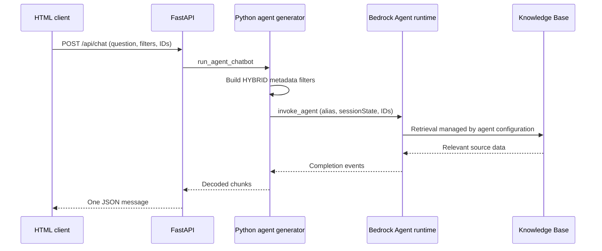

# Chatbot system architecture

The active `main-chatbot-service` path delegates conversation and retrieval to an externally configured Bedrock Agent. SQL/OpenSearch ingestion and local development tools are absent from this tree; the request uses the externally configured Knowledge Base.

## Runtime boundaries

The HTML page calls the fixed Lambda chat endpoint even when served locally. It separately submits interaction/feedback records to the production interaction service; tracking failure is independent of chat availability. There is no Streamlit entry point in this branch.

## Ownership

| Layer | Owned in repository | External dependency |
| --- | --- | --- |
| HTTP ingress | FastAPI routes/models, static serving, permissive CORS | Any gateway authentication and access policy |
| Runtime adapter | Uvicorn launcher, Mangum handler | Lambda/image/deployment environment |
| Conversation | Generator payload, caller IDs, chunk/error handling | Agent/alias configuration, model, memory policy |
| Retrieval | Metadata filter builder | KB association, index, metadata types, ingestion and HYBRID support |
| Interface | HTML/JS | Feedback service, browser network/CORS |
| Auxiliary uploads | Retained S3 helpers, not called by chat | Bucket permissions and separately managed ingestion |

## Data preparation is separate

The SQL loader, direct OpenSearch/LLM/KB modules and converter suite are not present here. Retained S3 helpers can create per-record CSV/metadata and upload them, but the active agent does not call them or start KB synchronization. Per-record errors may be logged while processing continues, so helper completion is not evidence of complete ingestion.

The route still reports reload metadata when requested; `data_reloaded` is not a freshness signal. The deployed agent's model, knowledge sources and memory are externally configured.

## State, privacy and operational constraints

- UI history is local browser state; the API forwards IDs to AWS without storing a transcript locally.
- Provider memory behavior depends on external settings. New local sessions do not delete it.
- Email entry does not authenticate users, and local-part memory IDs can collide.
- Logs/standard output can contain question/answer text and identifiers; external interaction tracking also transfers content.
- `/health` checks no upstream dependency. Provider errors can return friendly answer text with HTTP 200.
- Buffered API output and synchronous generator consumption provide no established throughput or latency guarantee.

See [API details](API.md), [maintenance map](../TECHNICAL_DOCUMENTATION.md) and [production differences](BRANCH_DIFFERENCES.md) before changing these boundaries.
