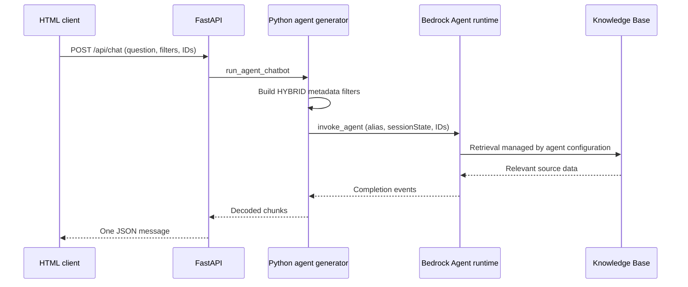

# Chatbot system architecture

The active `dev-chatbot-service` path delegates conversation and retrieval to an externally configured Bedrock Agent. It does not run the auxiliary SQL/OpenSearch ingestion pipeline for each query.

## Runtime boundaries

Streamlit replaces the HTTP boundary with a direct generator call and progressively displays output. HTML and Streamlit separately submit interaction/feedback records to an external service; tracking failure is independent of chat availability.

## Ownership

| Layer | Owned in repository | External dependency |
| --- | --- | --- |
| HTTP ingress | FastAPI routes/models, static serving, permissive CORS | Any gateway authentication and access policy |
| Runtime adapter | Uvicorn launcher, Mangum handler | Lambda/image/deployment environment |
| Conversation | Generator payload, caller IDs, chunk/error handling | Agent/alias configuration, model, memory policy |
| Retrieval | Metadata filter builder | KB association, index, metadata types, ingestion and HYBRID support |
| Interface | HTML/JS and Streamlit | Feedback service, browser network/CORS |
| Auxiliary preparation | SQL exports, S3 helpers, OpenSearch path | Database permissions, native ODBC, AWS resources |

## Data preparation is separate

`db_conn/sql_connection.py` contains view definitions and can execute CREATE OR ALTER VIEW before extraction. It transforms tables, writes JSONL/CSV and calls a helper that creates per-record CSV/metadata files and uploads them to S3. It can log failures and return an empty DataFrame; per-record upload failures can be logged while processing continues. Successful script completion alone does not prove complete ingestion.

The repository's active agent does not run this pipeline or start KB synchronization. The route still reports reload metadata when requested, so its `data_reloaded` field is not a freshness signal. The direct OpenSearch/embedding/LLM modules are auxiliary implementations, not proof of the agent's deployed model or vector storage.

## State, privacy and operational constraints

- UI history is local browser/Streamlit state; the API forwards IDs to AWS without storing a transcript locally.
- Provider memory behavior depends on external settings. New local sessions do not delete it.
- Email entry does not authenticate users, and local-part memory IDs can collide.
- Logs/standard output can contain question/answer text and identifiers; external interaction tracking also transfers content.
- `/health` checks no upstream dependency. Provider errors can return friendly answer text with HTTP 200.
- Buffered API output and synchronous generator consumption provide no established throughput or latency guarantee.

See [API details](API.md), [maintenance map](../TECHNICAL_DOCUMENTATION.md) and [production differences](BRANCH_DIFFERENCES.md) before changing these boundaries.
