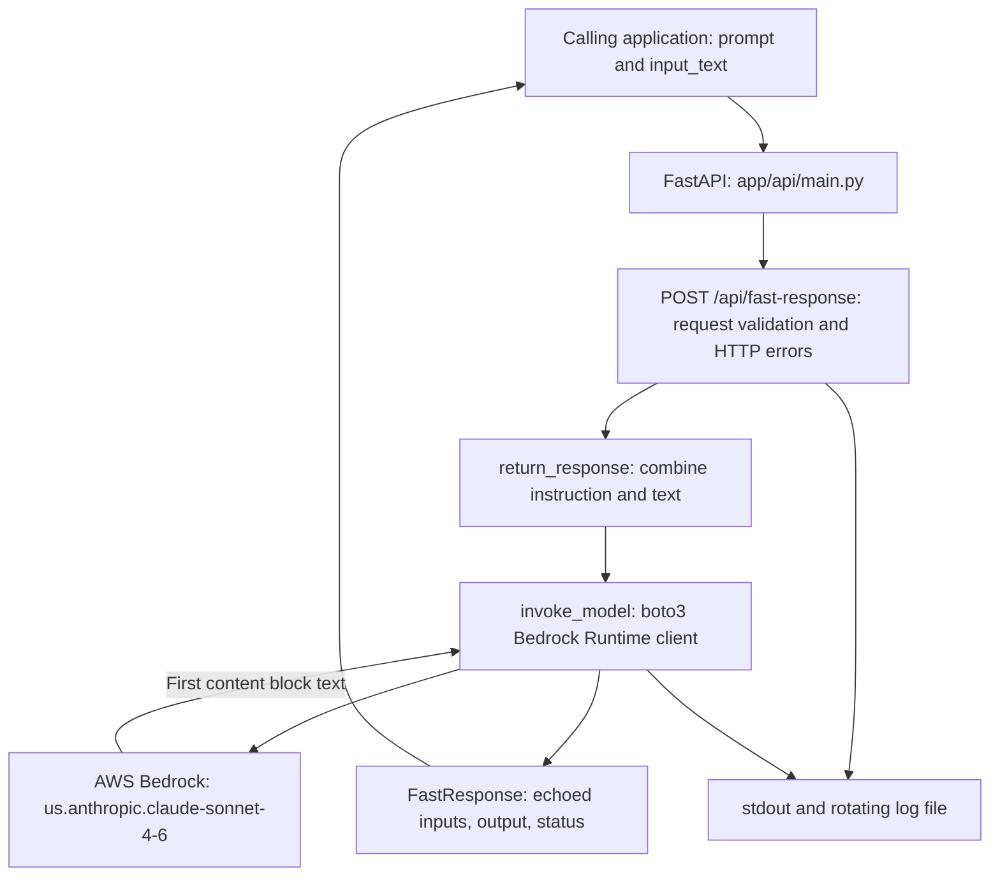

# Fast Response Service

Fast Response Service applies a caller-supplied instruction to input text through AWS Bedrock and returns generated text as JSON. Typical uses include summarization, rewriting, translation, and drafting replies. This service contains a Python API; it has no dedicated frontend, document ingestion pipeline, vector database, or conversation store.

This README describes `main-fast-response`. This branch writes file logs to `/tmp/logs/app.log`, including when run locally; see [branch differences](docs/BRANCH_DIFFERENCES.md). Model quality, response time, and deployed access controls require separate verification.

## Start here

| Goal | Read |
| --- | --- |
| Run locally | [Quick start](#quick-start) |
| Understand the service's scope | [Product overview](docs/PRODUCT_OVERVIEW.md) |
| Integrate requests and handle errors | [API guide](docs/API_GUIDE.md) |
| Follow components and provider calls | [System architecture](#system-architecture), [detailed design](docs/HIGH_LEVEL_DESIGN.md) |
| Continue implementation | [Agent guide](AGENTS.md) |
| Review branch integration | [Branch differences](docs/BRANCH_DIFFERENCES.md) |
| Diagnose common failures | [Troubleshooting](#troubleshooting) |

## Quick start

### 1. Enter the service and install dependencies

From the monorepo root, using Python 3.13:

```bash
cd fast-response-service
python3.13 -m venv .venv
source .venv/bin/activate
python -m pip install -r requirements.txt
```

Docker also installs `requirements.txt`. `pyproject.toml` and `uv.lock` provide another dependency declaration/lockfile; the pip command above does not install the locked versions from `uv.lock`. Do not assume a monorepo-wide environment or test command.

### 2. Configure AWS access

Create `.env` in this service directory if using the service-specific credential variables:

```env
AWS_ACCESS_KEY_ID_BR=YOUR_AWS_ACCESS_KEY_ID
AWS_SECRET_ACCESS_KEY_BR=YOUR_AWS_SECRET_ACCESS_KEY
```

Use credentials for the intended environment supplied outside Git, or an appropriate standard boto3 credential source when those variables are unset. The current model is `us.anthropic.claude-sonnet-4-6`, invoked through a Bedrock Runtime client explicitly configured for `us-east-1`.

`AWS_REGION` is read into the configuration dictionary but does **not** override this client's hardcoded region. There is no model-ID environment override. See [configuration](#configuration) before changing either behavior.

### 3. Start the API

From the service directory with the virtual environment active:

```bash
python api_server.py --host 127.0.0.1 --reload
```

Equivalent direct entry point:

```bash
python -m uvicorn app.api.main:app --host 127.0.0.1 --port 8000 --reload
```

`main.py` exports the Lambda handler; it is not the local server launcher. The launcher's help/docstring still contains an older AICCRA Report Generator label, but its Uvicorn target is this Fast Response application.

| Local resource | URL |
| --- | --- |
| API metadata | [Root](http://localhost:8000/) |
| Interactive API reference | [Swagger UI](http://localhost:8000/docs) |
| API reference | [ReDoc](http://localhost:8000/redoc) |
| OpenAPI schema | [Schema](http://localhost:8000/openapi.json) |
| Process health | [Health](http://localhost:8000/health) |

### 4. Verify startup

In another terminal:

```bash
curl http://localhost:8000/health
```

Expected response:

```json
{
  "status": "healthy",
  "service": "Fast Response API",
  "version": "1.0.0"
}
```

Health does not invoke Bedrock or confirm credentials, model access, or successful generation. Importing the application constructs the AWS client and initializes file logging, so configuration/filesystem errors can prevent startup before health is available.

## System architecture



The same FastAPI application runs locally through Uvicorn and in the Lambda container through Mangum's `main.handler`. There is no frontend/backend intermediary or retrieval layer inside this service. The [detailed design](docs/HIGH_LEVEL_DESIGN.md) explains synchronous provider calls, timeouts, and response parsing.

## Project structure

```text
fast-response-service/
├── README.md                     # Setup, architecture, usage, operations
├── AGENTS.md                     # Implementation map and working rules
├── docs/                         # API, product, design, branch comparison
├── api_server.py                 # Local Uvicorn CLI
├── main.py                       # Mangum Lambda handler
├── Dockerfile                    # Lambda Python 3.13 image
├── requirements.txt              # Dependencies installed by Docker/pip
├── pyproject.toml                # Local project/dependency metadata
├── uv.lock                       # uv dependency lockfile
└── app/
    ├── api/
    │   ├── main.py               # App, CORS, metadata, health, global errors
    │   ├── models.py             # FastRequest, FastResponse, ErrorResponse
    │   └── routes.py             # Generation route and error mapping
    ├── llm/mining.py              # Prompt composition and Bedrock invocation
    └── utils/
        ├── config/config_util.py # dotenv and AWS configuration
        └── logger/logger_util.py # stdout and rotating file logging
```

`.env`, virtual environments, and generated logs are local artifacts. This service-main branch creates file logs at `/tmp/logs/app.log`; development uses service-relative `data/logs/app.log`.

## API and usage

| Method | Path | Behavior |
| --- | --- | --- |
| GET | `/` | Return service/version/documentation metadata |
| GET | `/health` | Return process health metadata without provider checks |
| POST | `/api/fast-response` | Apply `prompt` to `input_text` and return generated text |

Both request fields are required strings. Current schemas do not require nonempty strings or set text-length limits. No API-key/token dependency or rate limit is implemented in these routes. CORS allows all origins; it does not establish access control. Infrastructure controls, if any, must be verified separately.

The following generation examples invoke Bedrock when run against a configured server and may incur charges. All text is fictional, and the shown output is illustrative.

### cURL

```bash
curl -X POST http://localhost:8000/api/fast-response \
  -H 'Content-Type: application/json' \
  -d '{"prompt":"Summarize in one sentence","input_text":"Example farmers rotate crops and conserve water."}'
```

Successful response shape:

```json
{
  "prompt": "Summarize in one sentence",
  "input_text": "Example farmers rotate crops and conserve water.",
  "output": "The example describes crop rotation and water conservation.",
  "status": "success"
}
```

### Python

Using a client environment with `requests` installed:

```python
import requests

response = requests.post(
    "http://localhost:8000/api/fast-response",
    json={
        "prompt": "Translate to Spanish",
        "input_text": "This is a fictional research summary."
    },
    timeout=360,
)
response.raise_for_status()
print(response.json()["output"])
```

### JavaScript

```javascript
const response = await fetch('http://localhost:8000/api/fast-response', {
  method: 'POST',
  headers: { 'Content-Type': 'application/json' },
  body: JSON.stringify({
    prompt: 'Suggest a short title',
    input_text: 'A fictional article about crop rotation.'
  })
});
if (!response.ok) {
  throw new Error(`Generation failed: ${response.status}`);
}
const result = await response.json();
console.log(result.output);
```

The Python timeout is an example client setting, not an end-to-end deadline: SDK retries and deployment limits affect actual waiting. See the [API guide](docs/API_GUIDE.md) for 400/422/500 handling. Route errors are wrapped under `detail`; FastAPI schema errors use its validation-error list.

## Configuration

| Setting | Current source and effect |
| --- | --- |
| AWS access key/secret | `AWS_ACCESS_KEY_ID_BR`, `AWS_SECRET_ACCESS_KEY_BR` in `config_util.py`; passed to boto3. If unset, boto3 can resolve its standard credential sources. |
| AWS region | `mining.py` explicitly uses `us-east-1`; the configured `AWS_REGION` dictionary value is not passed to this client. |
| Model ID | `us.anthropic.claude-sonnet-4-6`, hardcoded in `mining.py` |
| Model request | Anthropic messages payload; `max_tokens=4000`, `temperature=0.1`, version `bedrock-2023-05-31` |
| SDK timeouts/retries | Connect 60 seconds, read 300 seconds; adaptive retries with `max_attempts=3` |
| Server options | `api_server.py`: host `0.0.0.0`, port 8000, reload off, log level info by default |

```bash
python api_server.py --help
python api_server.py --host 127.0.0.1 --port 8001 --log-level debug
```

Changing a model ID, prompt composition, region, or generation parameter changes behavior. Review the request format and compatible response parsing with such a change; substituting a model ID alone does not demonstrate compatibility or availability.

## Deployment and branch workflow

The existing Dockerfile uses `public.ecr.aws/lambda/python:3.13`, installs `requirements.txt`, and starts `main.handler`. It is a Lambda image, not the generic port-8000 Uvicorn image shown in the older README.

The current Dockerfile explicitly copies `.env` and then the build context into the image; it expects that file in the context. Git ignore rules do not control Docker copying. Account for this existing packaging behavior when reviewing builds and credential handling. This documentation update does not change or build the image.

```text
task branch from dev-fast-response
    → dev-fast-response → main-fast-response → staging → main
```

The checked workflow triggers Jenkins on pushes to `main-fast-response`, pull requests targeting that branch, and manual dispatch. It has no documentation path exclusion. No workflow matching `dev-fast-response` was found in the reviewed checkout; this does not establish whether Jenkins has separate external triggers. See [branch differences](docs/BRANCH_DIFFERENCES.md) before the maintainer's service-main integration. Completed service work accumulates in staging for the agreed consolidated PR to main.

## Troubleshooting

| Symptom | What to check |
| --- | --- |
| `.venv/bin/python` cannot run after a Python installation changes | Check whether the environment points to a removed interpreter. Recreate the service environment with Python 3.13 and reinstall requirements; an existing local virtual environment is not a portable project artifact. |
| AWS credential errors | Inspect the selected credential source and configured variable names without printing secrets. Health alone does not validate credentials. |
| Model/permission/region errors | Confirm access to the exact hardcoded model/profile and `us-east-1`. Setting `AWS_REGION` alone does not move this client. |
| HTTP 422 | Check JSON syntax, both required string fields, and the validation details. Empty strings are currently accepted locally. |
| HTTP 400 or 500 | Inspect the nested `detail` object and relevant logs; see [error semantics](docs/API_GUIDE.md#errors). A caught `ValueError` becomes 400, while other generation failures become 500. |
| Incomplete output with HTTP 200 | The response contains only the first Bedrock content block. Non-`end_turn` stop reasons are logged, not exposed as API failure; token/stop metadata is not returned. |
| Port 8000 is occupied | Choose another port with `python api_server.py --port 8001` and update the client's URL. |
| Read-only filesystem or log initialization failure | This branch creates `/tmp/logs` during import and writes `/tmp/logs/app.log`. Check directory permissions and preserve this service-main path; development uses service-relative `data/logs`. |
| Docker build cannot find `.env` | The current Dockerfile explicitly copies it; review the build inputs and packaging behavior described above. |

Logs use stdout plus a rotating file (5 MiB, five backups), with logger level DEBUG. The route logs the complete supplied prompt, and model calls log token usage and stop reason. Avoid embedding credentials or sensitive data in prompts and shared diagnostics. Changing Uvicorn's `--log-level` does not reconfigure the service logger's DEBUG constant.

## Validation and references

No service-specific automated test suite or lint configuration was found in this checkout. For documentation checks, verify links, examples, route schemas, prompt composition, and provider parsing with network blocked and a fake Bedrock client. Do not use generation examples as a free readiness check.

Local/offline checks do not validate model quality, live permissions, deployed timeouts, or Jenkins results. No fixed latency or accuracy guarantee follows from the service's name.

The repository [LICENSE](../LICENSE) contains Apache License 2.0. The application's OpenAPI metadata currently labels the API MIT; this mismatch is recorded here without changing licensing metadata in a documentation-only task.
