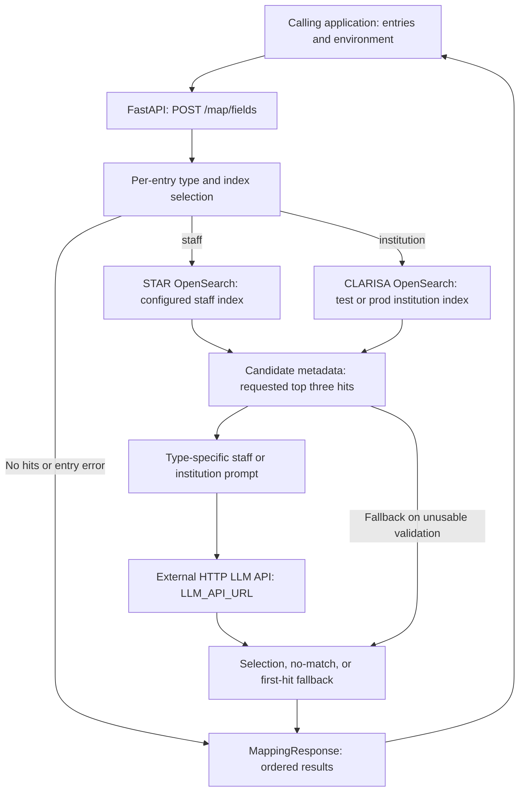

# Mapping Service

Mapping Service resolves free-text staff and institution names to identifiers from configured OpenSearch catalogs. It retrieves candidates with text/fuzzy queries, then asks an external LLM API to select a candidate or reject the match. Staff IDs come from STAR's `carnet`; institution IDs come from CLARISA's `code`.

This guide describes `dev-mapping`. Service-main differs in packaging, Lambda dependencies, and logging; see [branch differences](docs/BRANCH_DIFFERENCES.md). The implemented retrieval uses text queries, not a vector/embedding search. There is no dedicated frontend or local catalog database.

## Start here

| Goal | Read |
| --- | --- |
| Run locally | [Quick start](#quick-start) |
| Understand the workflow | [Product overview](docs/PRODUCT_OVERVIEW.md) |
| Integrate the API and interpret scores | [API guide](docs/API_GUIDE.md) |
| Follow components and external calls | [System architecture](#system-architecture), [detailed design](docs/HIGH_LEVEL_DESIGN.md) |
| Continue implementation | [Agent guide](AGENTS.md) |
| Prepare service-main integration | [Branch differences](docs/BRANCH_DIFFERENCES.md) |
| Diagnose failures or missing matches | [Troubleshooting](#troubleshooting) |

## Quick start

### 1. Install local dependencies

From the monorepo root, using Python 3.13:

```bash
cd mapping-service
python3.13 -m venv .venv
source .venv/bin/activate
python -m pip install -r requirements.txt
```

This installs the local API dependencies. The development `requirements.txt` does not include `mangum`, although `pyproject.toml` declares it and `main.py` imports it for Lambda. That mismatch does not affect the documented Uvicorn entry point. No `uv.lock` or Dockerfile is present in this development tree; do not copy service-main deployment assumptions into local setup.

### 2. Configure the external services

Create `.env` in `mapping-service/` with values for the intended catalogs and LLM endpoint. Example placeholders:

```env
STAR_OPENSEARCH_URL=https://star-search.example
STAR_OPENSEARCH_BASE_INDEX=example-staff-index
STAR_OPENSEARCH_USERNAME=YOUR_STAR_USERNAME
STAR_OPENSEARCH_PASSWORD=YOUR_STAR_PASSWORD
CLARISA_OPENSEARCH_URL=https://clarisa-search.example
CLARISA_OPENSEARCH_PROD_INDEX=example-institutions-prod
CLARISA_OPENSEARCH_TEST_INDEX=example-institutions-test
CLARISA_OPENSEARCH_USERNAME=YOUR_CLARISA_USERNAME
CLARISA_OPENSEARCH_PASSWORD=YOUR_CLARISA_PASSWORD
LLM_API_URL=http://localhost:8000/api/fast-response
```

The OpenSearch URLs are base URLs; code appends the selected index and `/_search`. `LLM_API_URL` is the complete generation endpoint. It receives `prompt` and `input_text`; the [Fast Response service](../fast-response-service/README.md) is one compatible API shape, but Mapping does not start it or select a model itself.

Configuration is loaded into module-level values during import. Restart the service after changing `.env`. Use supplied environment values rather than the fictional search URLs above, and keep credentials out of commits.

### 3. Start the API

```bash
python api_server.py --host 127.0.0.1 --reload
```

The launcher's actual default port is **8001**. Its help text incorrectly mentions 8000, and its printed `/health` URL does not correspond to an implemented route. Equivalent direct command:

```bash
python -m uvicorn app.api.main:app --host 127.0.0.1 --port 8001 --reload
```

| Local resource | URL |
| --- | --- |
| Swagger UI | [API documentation](http://localhost:8001/docs) |
| ReDoc | [API reference](http://localhost:8001/redoc) |
| OpenAPI schema | [Schema](http://localhost:8001/openapi.json) |
| Mapping operation | `POST http://localhost:8001/map/fields` |

There is no `GET /` or `/health` application route in this checkout. `main.py` exposes `main.handler` for Lambda; it is not the local server launcher.

### 4. Check the local route without external searches

In another terminal:

```bash
curl -X POST http://localhost:8001/map/fields \
  -H 'Content-Type: application/json' \
  -d '{"entries":[],"environment":"test"}'
```

Expected response:

```json
{"results": []}
```

An empty batch makes no OpenSearch/LLM requests. This confirms local route execution, not catalog access or match quality. Actual nonempty mapping requests contact the configured services and can invoke a paid LLM API.

## System architecture



Entries are processed sequentially. OpenSearch uses HTTP Basic authentication; the LLM request sends JSON without an authentication header in this implementation. Mapping does not directly call Bedrock or maintain embeddings. Its prompts live in Python modules, and the selected LLM/model depends on the configured external endpoint.

The [detailed design](docs/HIGH_LEVEL_DESIGN.md) covers query construction, parsing, timeouts, logging, and branch-specific runtime behavior.

## Project structure

```text
mapping-service/
├── README.md                       # Setup, architecture, usage, operations
├── AGENTS.md                       # Implementation map and working rules
├── docs/                           # API, product, design, branch comparison
├── api_server.py                   # Local Uvicorn CLI, default port 8001
├── main.py                         # Mangum Lambda handler
├── requirements.txt                # Development local API dependencies
├── pyproject.toml                  # Project metadata; also declares mangum
└── app/
    ├── api/
    │   ├── main.py                 # FastAPI app and /map router registration
    │   ├── models.py               # Request and result schemas
    │   └── routes.py               # POST /fields under the /map prefix
    ├── mapping/opensearch_mapping.py # Search, normalization, LLM parsing, fallback
    └── utils/
        ├── config/config_util.py   # dotenv and catalog/LLM configuration
        ├── logger/logger_util.py   # stdout and rotating file logger
        └── prompts/
            ├── prompt_staff.py
            └── prompt_institutions.py
```

`.env`, virtual environments, and generated logs are local artifacts. This branch writes logs to service-relative `data/logs/app.log`. Service-main has a different log-directory resolver and an additional Dockerfile.

## API and examples

`POST /map/fields` takes a JSON object containing `entries` and optional `environment`. Each entry has a string `value` and a `type` of `staff` or `institution`.

```json
{
  "entries": [
    {"value": "Example Person", "type": "staff"},
    {"value": "Example Research Institute", "type": "institution"}
  ],
  "environment": "test"
}
```

**Omitting `environment` selects `prod`**, even on the development branch. This field changes only the CLARISA institution index. Staff always uses `STAR_OPENSEARCH_BASE_INDEX`; it does not switch staff credentials, the LLM endpoint, logging, or the Git branch's deployment settings.

Illustrative successful response:

```json
{
  "results": [
    {
      "original_value": "Example Person",
      "type": "staff",
      "mapped_id": "EXAMPLE-001",
      "mapped_name": "Example Person",
      "mapped_acronym": null,
      "score": 94
    },
    {
      "original_value": "Example Research Institute",
      "type": "institution",
      "mapped_id": "9001",
      "mapped_name": "Example Research Institute",
      "mapped_acronym": "ERI",
      "score": 92
    }
  ]
}
```

These names, identifiers, and scores are fictional. Real results depend on catalogs and LLM output. Array order follows input order, including duplicate input values.

### Python

Using a client environment with `requests` installed:

```python
import requests

response = requests.post(
    "http://localhost:8001/map/fields",
    json={
        "entries": [{"value": "Example Research Institute", "type": "institution"}],
        "environment": "test",
    },
    timeout=360,
)
response.raise_for_status()
for result in response.json()["results"]:
    print(result["original_value"], result["mapped_id"], result["score"])
```

The client timeout is illustrative. It does not impose a server-side deadline or establish that a timed-out request made no external calls.

## Matching and score semantics

OpenSearch queries combine original text with an accent-stripped ASCII variant, `multi_match` clauses, and fuzzy clauses. Staff queries target first/last names; institution queries target acronym/name. Search requests ask for three hits.

The LLM receives candidate positions and metadata. A selected candidate uses the returned `confidence_score`; the API does not enforce the prompt's suggested minimum confidence or a 0–100 bound. If LLM validation fails or returns an out-of-range integer selection, the service can choose the first OpenSearch hit with a **fixed score of 90**. This score is not the OpenSearch relevance score or a measured probability.

No hits, a no-match decision, or a caught per-entry error produces null mapped fields and score 0. These outcomes are indistinguishable in the public response. There is no fallback/error/source flag, so HTTP 200 and score 90 alone do not prove successful LLM validation. See [API semantics](docs/API_GUIDE.md#selection-and-scores) for exact cases.

## Configuration and runtime

| Setting | Effect |
| --- | --- |
| `STAR_OPENSEARCH_URL`, `STAR_OPENSEARCH_BASE_INDEX` | Staff search host and index, for both request environments |
| `STAR_OPENSEARCH_USERNAME`, `STAR_OPENSEARCH_PASSWORD` | Staff search Basic auth |
| `CLARISA_OPENSEARCH_URL` | Institution search host |
| `CLARISA_OPENSEARCH_TEST_INDEX`, `CLARISA_OPENSEARCH_PROD_INDEX` | Institution index selected by the request's environment |
| `CLARISA_OPENSEARCH_USERNAME`, `CLARISA_OPENSEARCH_PASSWORD` | Institution search Basic auth |
| `LLM_API_URL` | Full generation endpoint; no model ID is configured inside Mapping |
| `LOGS_DIR` | Not consumed by the development logger; service-main tries it first |

The route has no implemented API-key/token dependency, rate limiter, or CORS middleware. OpenSearch credentials authenticate outbound searches; they do not authenticate callers of `/map/fields`. Deployment access controls must be checked separately.

The async route directly executes synchronous HTTP calls. The OpenSearch request has no explicit timeout; the LLM request uses 300 seconds. Multiple entries can make multiple sequential provider calls, so there is no bounded batch latency established by this implementation.

## Deployment and promotion

```text
task branch from dev-mapping
    → dev-mapping → main-mapping → staging → main
```

This development branch has no Dockerfile. Service-main has a Lambda Python 3.13 Dockerfile, includes `mangum` in requirements, and uses a logger resolver that tries `LOGS_DIR`, the service log directory, then `/tmp/mapping-service/logs`. Preserve those differences during integration rather than replacing them with development assumptions.

The service-main Dockerfile copies `.env` and the full build context into its image. This is a description of that branch's packaging, not a verified build or deployment. No Mapping-specific GitHub workflow was found among the reviewed workflows; external Jenkins triggers are not established by that absence.

After the maintainer's local merge, compare the resulting tree and **adjust the main-specific documentation before push**. The [branch guide](docs/BRANCH_DIFFERENCES.md) records files, dependencies, and logging behavior to check. Completed service work accumulates in staging for the agreed consolidated PR to main.

## Troubleshooting

| Symptom | What to check |
| --- | --- |
| `/health` or `/` returns 404 | These routes are not implemented, despite the launcher's printed health URL. Use `/openapi.json` or the empty-batch check above. |
| The server is not on port 8000 | The launcher defaults to 8001. Set `--port` explicitly if needed; its help text is stale. |
| HTTP 422 | Check the required entries array, string values, exact type literals, and `environment` (`test` or `prod`). One invalid entry rejects the request before mapping starts. |
| HTTP 200 but all IDs are null | Check logs and OpenSearch credentials/indices/connectivity. No hits, LLM rejection, malformed selection, and per-entry errors can all yield null/0 results. |
| A match scores 90 during LLM outages | First-hit fallback assigns 90. The response does not identify fallback separately from an LLM-selected match. |
| Staff does not change with `environment=test` | Staff always uses the configured STAR index. The environment selector affects institution indexing only. |
| Configuration changes appear ineffective | Restart after editing `.env`; configuration values are captured at import. |
| Log initialization fails on a read-only filesystem | Development creates service-relative `data/logs` during import. Main's resolver differs; check [branch differences](docs/BRANCH_DIFFERENCES.md). |
| Lambda import fails because Mangum is missing | Development requirements omit `mangum`; pyproject and service-main requirements include it. Review the target dependency source before preparing deployment. |

Logs use stdout and a rotating file (5 MiB, five backups), with logger level DEBUG. They can contain search terms, candidate names/IDs, and LLM decisions or extracted response text. Staff candidate email/center metadata is sent to the LLM when present. Use fictional data in examples and redact shared diagnostics.

## Validation and references

No service-specific test suite or lint configuration was found in the reviewed tree. Documentation/offline checks should verify schemas, test/prod routing, query normalization, LLM result parsing, fallback scores, and mixed-batch behavior using mocked HTTP clients and blocked network connections.

An empty-batch check or offline mock does not verify live catalogs, credentials, model quality, Jenkins, or Lambda availability. See the repository [LICENSE](../LICENSE) for its Apache 2.0 text.
