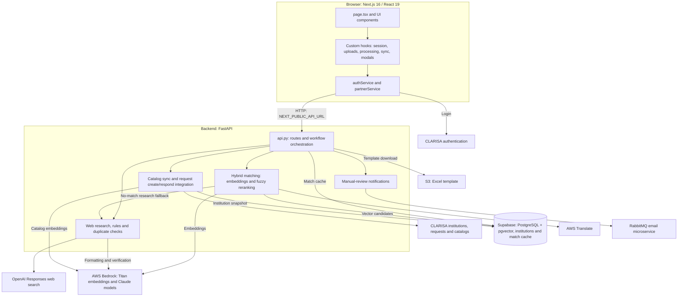

# Partner Request Support

Partner Request Support compares proposed institutions with the CLARISA institution catalog and supports manual review, web research, and an optional automated decision flow. It contains a FastAPI backend and a Next.js frontend exported as static files.

This documentation describes `main-partner-request-support`, the service-main branch. It selects the production cache table, CLARISA login host, and environment label; see [branch differences](docs/BRANCH_DIFFERENCES.md). Repository checks do not certify live CLARISA contracts, model accuracy, or deployment availability.

## Start here

| Goal | Documentation |
| --- | --- |
| Start the application locally | [Quick start](#quick-start) |
| Understand supported workflows | [Product overview](docs/PRODUCT_OVERVIEW.md) |
| Run/configure the backend | [Backend README](backend/README.md) |
| Run/configure the frontend | [Frontend README](frontend/README.md) |
| Integrate API calls and understand side effects | [API guide](docs/API_GUIDE.md) |
| Follow components and storage | [System architecture](#system-architecture), [high-level design](docs/HIGH_LEVEL_DESIGN.md) |
| Understand matching scores | [How the search works](backend/docs/HOW%20THE%20SEARCH%20WORKS.md) |
| Continue work with an agent | [Service guide](AGENTS.md), [frontend guide](frontend/AGENTS.md) |
| Locate implementation files | [Project structure](#project-structure) |
| Diagnose setup and workflow issues | [Troubleshooting](#troubleshooting) |

## Quick start

You need Python 3.13, Node.js/npm compatible with the frontend lockfile, and access to the intended Supabase, CLARISA, AWS, and OpenAI resources. This branch retains production login/cache choices even when run locally; use `dev-partner-request-support` for the development defaults. Use an existing prepared database for the intended environment; first-time database provisioning is covered in the [backend setup guide](backend/README.md#database-and-operational-setup).

### 1. Prepare the backend

From the monorepo root:

```bash
cd partner-request-support/backend
python3.13 -m venv .venv
source .venv/bin/activate
python -m pip install -r requirements.txt
```

Create `.env` in the backend directory using the [configuration example and variable table](backend/README.md#configuration). Supply values for the intended environment for Supabase, OpenAI, the CLARISA URLs, and AWS access. The selected cache table remains `partner_request_cache_prod`; `.env` does not switch that code constant. The URLs in the example are placeholders; provider clients are constructed during import, so configuration must be ready before starting the API.

### 2. Start the API

In the same terminal, with the virtual environment active:

```bash
python -m uvicorn api:app --host 127.0.0.1 --port 8000 --reload
```

The local entry point is `api:app`. `main.handler` is the separate Lambda entry point. API documentation is available at [Swagger UI](http://localhost:8000/docs) and [ReDoc](http://localhost:8000/redoc).

### 3. Start the frontend

Open another terminal at the monorepo root:

```bash
cd partner-request-support/frontend
npm ci
```

Create `.env.local` in this frontend directory with:

```env
NEXT_PUBLIC_API_URL=http://localhost:8000
```

Then start the UI:

```bash
npm run dev
```

Open [the local application](http://localhost:3000). Login in this branch uses the production CLARISA authentication host independently of `NEXT_PUBLIC_API_URL`; see the [frontend setup guide](frontend/README.md).

### 4. Check startup and choose a workflow

From a third terminal:

```bash
curl http://localhost:8000/health
```

The expected response is `{"status":"healthy"}`. This confirms that the API is running; it does not check its external dependencies. Sign in to the UI to use the review workflow. Before uploading or processing, read the [workflow effects](#workflows): Excel upload creates CLARISA requests by default, and processing can synchronize catalog records, write cache, and call models. These actions affect configured resources even when the app runs locally.

## Project structure

```text
partner-request-support/
├── README.md                 # Service entry point and local quick start
├── AGENTS.md                 # Service working rules and implementation map
├── docs/                     # API, workflows, architecture, branch differences
├── backend/
│   ├── README.md             # Backend setup and configuration
│   ├── api.py                # HTTP routes and request orchestration
│   ├── main.py               # Mangum Lambda handler
│   ├── src/                  # Matching, CLARISA, storage, research, notifications
│   ├── config/               # AWS and email configuration
│   ├── sql/                  # Institution schema/RPCs and branch-specific cache
│   ├── docs/                 # Search algorithm, quickstart, rules reference
│   ├── test/                 # Examples that can call live systems
│   ├── requirements.txt      # Dependencies installed by Docker
│   ├── Dockerfile            # Lambda container
│   └── template.yaml         # Backend SAM template
└── frontend/
    ├── README.md             # Frontend setup and workflow
    ├── AGENTS.md             # Frontend working rules
    ├── app/                  # Pages, components, hooks, services, types, utilities
    ├── docs/                 # Historical refactoring note
    ├── package.json          # Frontend dependencies and npm scripts
    ├── next.config.ts        # Static-export configuration
    └── template.yaml         # S3/CloudFront hosting template
```

For individual modules and responsibilities, see the [service implementation map](AGENTS.md#implementation-map) and [frontend code map](frontend/README.md#code-map).

## System architecture

The browser application handles login, Excel upload, pending-request review, candidate inspection, and human decisions. Its service layer calls CLARISA authentication directly and sends processing requests to the Python API.



The frontend is exported as static files for S3/CloudFront hosting. The backend runs locally through Uvicorn; the SAM template defines an HTTP API/Lambda container path using Mangum's `main.handler`. These deployment definitions do not verify the currently deployed environment.

Human review and automatic evaluation share matching/research modules but use different decision rules. The automatic endpoint can be called separately from the UI. Only configured manual-review notifications are published to the email microservice; CLARISA handles notifications for submitted accept/reject responses. See the [detailed design](docs/HIGH_LEVEL_DESIGN.md) for state boundaries, provider models, and the two processing pipelines.

## Workflows

| Workflow | Entry | Behavior |
| --- | --- | --- |
| Spreadsheet review | `POST /api/process-partners` | Synchronize institutions, optionally create CLARISA requests, match spreadsheet rows, and cache results |
| Pending-request review | `GET /api/sync-partner-requests`, then `POST /api/process-api-partners` | Fetch pending CLARISA requests and process a default batch of ten, oldest first |
| Human response | `POST /api/respond-partner-request` | Accept/reject an existing request in CLARISA with the supplied user/token |
| Manual web research | `POST /api/manual-web-search` | Generate a research summary for a proposed institution |
| Automated evaluation | `POST /api/auto-partner-request` | Classify duplicates or run web/rules review; optionally create/respond in CLARISA |
| Catalog maintenance | `POST /api/sync-clarisa-institutions` | Update the Supabase institution snapshot/embeddings and optionally delete obsolete entries |

Processing is not a read-only search. Spreadsheet and pending-request processing synchronize database contents and update cache. Spreadsheet creation defaults to enabled, and the frontend explicitly enables it. Automated evaluation can perform web/model calls and send manual-review notifications even with auto-response disabled.

## Matching and decision boundaries

Matching uses Titan Text Embeddings V2, Supabase/pgvector candidates, language translation where applicable, and RapidFuzz reranking. The manual-review score is `0.60 × semantic + 0.30 × fuzzy name + 0.10 × fuzzy acronym`. Manual quality tiers are excellent at 0.85+, good at 0.70+, fair at 0.60+, otherwise no match.

Automated evaluation has its own tiers. An excellent score above 0.95 is treated as a duplicate and rejected; scores from 0.70 through 0.95 use a separate same-institution check. Unconfirmed duplicates, fair matches, and no-match cases proceed to web/rules evaluation, which returns ACCEPT or MANUAL_REVIEW. These tiers must not be interchanged with frontend review labels.

Field completeness is returned as information in the current automatic web/rules path; it is not an independent acceptance gate there. A score, model decision, or successful HTTP response is not a guarantee of institutional eligibility or a confirmed upstream response. See [API semantics](docs/API_GUIDE.md#automated-evaluation).

## Frontend and authentication

The Next.js app supports Excel upload, pending-request synchronization, ten-request processing batches, candidate inspection, manual web search, and human accept/reject actions. React hooks keep login state and results; the UI calls the configured Python API directly.

In this service-main branch, login targets `https://api.clarisa.cgiar.org/auth/login`, and the header displays Production Environment. The browser receives an access token and passes it as an internal `auth_token` value for creation/response operations. Those calls translate it to an upstream Bearer header.

The local FastAPI routes do not define a general authentication dependency. A frontend login does not establish protection of every backend route. Confirm infrastructure access controls and external catalog/endpoint contracts for the target environment.

## Storage and configuration

Supabase stores `clarisa_institutions_v2` and, in this branch, the production cache table `partner_request_cache_prod`. Development uses `partner_request_cache_test`. The table is selected by a code constant and matching SQL, not an environment flag. Preserve that distinction during integration.

Configuration includes Supabase access, CLARISA institution/pending/create/respond/catalog URLs, AWS Bedrock/Translate/S3 access, OpenAI, and optional RabbitMQ email settings. See the [backend configuration table](backend/README.md#configuration); no `.env.example` is included in the reviewed tree.

Cached results can be reused by normalized partner name. The batch API reassigns current request IDs; other cached source metadata can remain from the earlier result. Catalog changes can clear cached matches. The pending queue is a process-local snapshot fetched by sync (or recovered when empty), not a shared queue service.

## Runtime and integration

Use Python 3.13 for the Lambda backend path. The backend runs locally from `backend/` with Uvicorn and deploys as a Lambda container through Mangum's `main.handler`. Docker installs `requirements.txt`. The frontend uses Next.js 16.1.6 / React 19.2.3, static export, and S3/CloudFront infrastructure.

```text
task branch from dev-partner-request-support
    → dev-partner-request-support → main-partner-request-support → staging → main
```

After the maintainer's local service-main integration, compare cache constants/SQL, CORS, the frontend login host, and environment labels. Adapt service-main documentation before push rather than replacing production destinations with development values. Completed service updates accumulate in `staging` for the agreed consolidated PR to `main`.

The GitHub workflows trigger Jenkins on pushes to the development and service-main branches. They do not exclude documentation-only changes. The infrastructure templates describe deployment inputs, not verified live settings.

## Troubleshooting

Start with the API terminal output and the browser's Network panel to identify which request failed. Local backend logs also rotate under `backend/data/logs/app.log`; Lambda uses stdout/CloudWatch. Remove tokens and requester data before sharing diagnostics.

| Symptom | What to check |
| --- | --- |
| Backend fails during startup or reports a missing module | Activate the backend virtual environment and install its `requirements.txt` using that environment's Python. For provider configuration errors, check `backend/.env`, Supabase/OpenAI settings, and AWS credentials. Imports can fail before `/health` becomes available. |
| Supabase reports a missing relation or RPC function | Confirm the database selected by `SUPABASE_URL`, the required schema/functions, and the `partner_request_cache_prod` table selected by this branch. Compare the [institution SQL](backend/sql/create_clarisa_vector_table.sql) and [cache SQL](backend/sql/create_partner_cache_table.sql) with that database before applying changes. |
| Embedding dimension mismatch | Confirm Titan Text Embeddings V2 and the 1,024-dimensional columns/RPC parameters used by this service. Check the existing database schema before changing the model or regenerating vectors; see [matching details](backend/docs/HOW%20THE%20SEARCH%20WORKS.md). |
| UI cannot reach the API or the browser reports CORS errors | Check that the API is running, `NEXT_PUBLIC_API_URL` uses the intended host/port, and `CORS_ORIGINS` includes the frontend's exact origin, including its port. Restart the frontend after changing `.env.local`; a static deployment requires rebuilding its assets. |
| Login fails, or CLARISA rejects a create/respond call | Login uses the separate host in `frontend/app/services/authService.ts`. Confirm that the login environment, backend CLARISA URLs, user, and token belong to the intended environment. Changing the backend URL alone does not change the login host. |
| Pending requests appear out of date or only ten are processed | Explicitly synchronize pending requests to refresh the in-memory snapshot. With no selected IDs, processing chooses its ten oldest entries; an existing nonempty snapshot is reused. See [pending-request processing](docs/API_GUIDE.md#pending-request-processing). |
| Match results appear stale | Check whether the response reports a cache hit and whether catalog synchronization detected changes. Verify the branch-selected cache table before an intentional cache purge: `/api/clear-cache` deletes its contents. |
| Excel template download fails | Check the configured S3 bucket/key and AWS access. The default key is `PartnerRequestTemplate_v1.xlsx`; the deployed object must exist at the selected location. |
| `npm run lint` cannot find ESLint | Run `npm ci` from `frontend/` using a compatible Node.js version, then retry the defined npm script. This check is separate from starting or validating the backend. |

For request-body errors, compare the [API guide](docs/API_GUIDE.md) with the request actually sent: `process-api-partners` takes a bare array, while `sync-clarisa-institutions` takes a bare boolean. Confirm the current environment and upstream state before retrying a creation/response operation that may already have partially succeeded.

## Validation and references

The files in `backend/test/` are live search examples, not an isolated regression suite; one runs web searches at import. Do not run them as routine documentation checks. Offline checks should stub Supabase, CLARISA, AWS/model calls, and notifications and block network connections.

Validate examples, route/body shapes, batch selection, score boundaries, and automatic-decision branches separately from live provider accuracy. Frontend lint may report existing code issues; do not treat a documentation update as a validated build or deployment.

The [institution rules reference](backend/docs/CGIAR_INSTITUTION_RULES.md) is retained business context. Current executable routing is described in the API guide; this repository review is not an independent policy/legal determination. The [frontend refactoring note](frontend/docs/REFACTORING.md) records earlier structural work.
