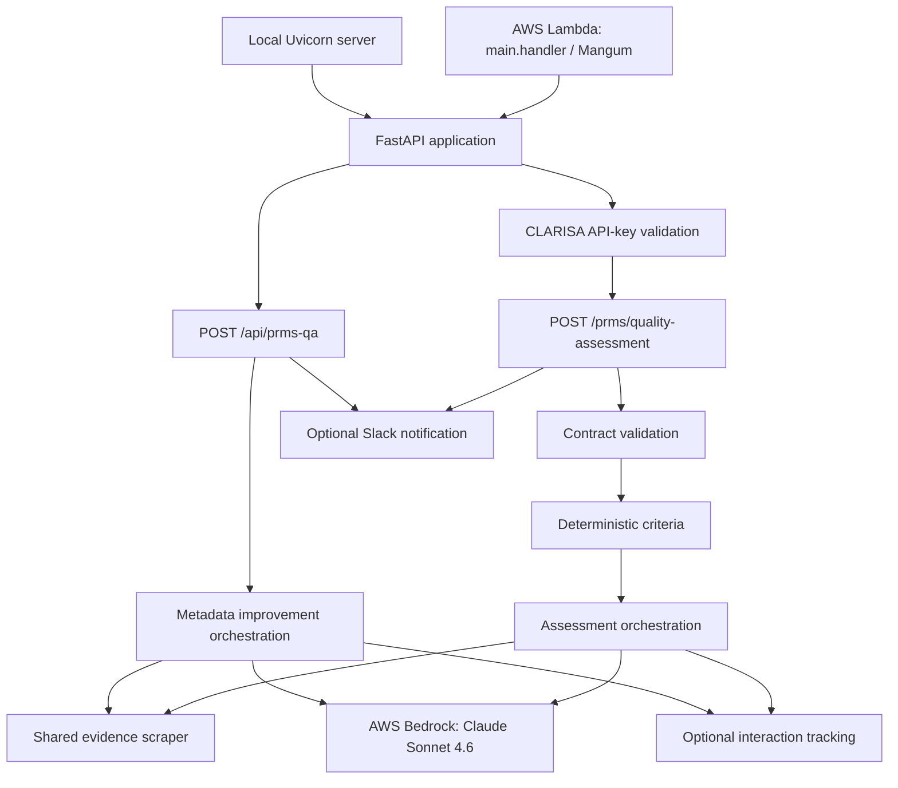

# PRMS QA Service: high-level design

The service hosts two workflows in one FastAPI application: metadata improvement and W3/Bilateral traffic-light assessment. They share evidence retrieval, logging, notifications, and interaction tracking, while keeping their LLM orchestration and response contracts separate.

This document describes repository code, not a verified deployment. Use the [README](../README.md) for setup and the [API guide](API_GUIDE.md) for request examples and response semantics.

## Runtime and component flow

Both routes return JSON to the caller. The service does not write an accepted change to PRMS or implement submission decisions.

| Component | Responsibility | Source |
| --- | --- | --- |
| Application and routes | HTTP API, authentication dependency, errors, notifications | [main.py](../app/api/main.py), [routes.py](../app/api/routes.py) |
| API models | Request/response schemas and section serialization | [models.py](../app/api/models.py) |
| Metadata improvement | Evidence context, prompt execution, output validation | [mining.py](../app/llm/mining.py), [schemas.py](../app/llm/schemas.py) |
| Assessment orchestration | Budget allocation, parallel tasks, finding assembly, coverage | [assessment.py](../app/llm/assessment.py) |
| Assessment model invocation | Forced tool calls, cache configuration, retries, semaphore | [bedrock_tools.py](../app/llm/bedrock_tools.py) |
| Criteria and rules | Catalog selection, deterministic evaluation, contract validation | [assessment utilities](../app/utils/assessment/) |
| Prompt construction | Metadata prompts and closed assessment tool schemas | [prompt utilities](../app/utils/prompt/) |
| Evidence retrieval | Source detection, extraction, validation, context formatting | [web_scraping.py](../app/web_scraping/web_scraping.py), [evidence_scraper.py](../app/web_scraping/evidence_scraper.py) |
| Integrations | Interaction analytics and Slack notifications | [interaction_client.py](../app/utils/interactions/interaction_client.py), [notification_service.py](../app/utils/notification/notification_service.py) |

## Metadata-improvement flow

1. FastAPI validates the `PrmsRequest` envelope. Its `result_metadata` member remains an open dictionary.
2. `improve_prms_result_metadata()` reads result type, level, and five impact-area score keys. Missing directly accessed keys become HTTP 400 errors at the route.
3. Evidence items marked private SharePoint files are skipped. The evidence enhancer attempts up to five URLs and formats their content. Enrichment failures are logged; rewriting can proceed without evidence context.
4. Knowledge Products run only the impact-area prompt. Other types run metadata and impact-area prompts concurrently with `asyncio.gather()`.
5. Bedrock output is parsed as JSON and checked against result-type-specific Pydantic schemas. Innovation Development adds `short_name`; Knowledge Product has no rewritten title or description.
6. If `user_id` is provided, the service attempts interaction tracking. The route then attempts a Slack notification and returns `PrmsResponse`.

Readiness-level and use-level prompt builders exist, but their extra model calls are commented out in this flow. Their presence is not evidence that those additional reviews execute.

## Traffic-light assessment flow

1. The request must include `X-API-Key`. The authentication dependency posts the key, endpoint, client IP, and microservice name `AI Traffic Light - PRMS` to CLARISA, with a five-second HTTP timeout.
2. Pydantic validates the request shape. The contract validator then checks result type, exact type-specific form labels, impact-area names/subcomponents, and selected closed vocabularies. Problems return HTTP 400 before assessment.
3. Deterministic metadata rules run against applicable catalog criteria. In parallel, evidence retrieval and the metadata LLM review execute.
4. The evidence LLM review runs after extraction, using the retrieved content. If no evidence content was retrieved, it returns unevaluated findings without making that model call.
5. Deterministic evidence rules and LLM findings are combined. Unknown criterion IDs cannot become valid catalog findings; omitted expected model findings remain unevaluated.
6. Aggregation computes section and overall verdicts from core and non-core flags. Scoring maps evaluated findings into verdict-compatible score bands.
7. The response identifies affected form inputs in `fields`. Valid replacement text can appear only on amber/red General Information. Other Output and Other Outcome omit `type_specific` from the serialized section response.
8. The service reports coverage, attempts optional tracking, and the route attempts a Slack notification before returning.

The criteria catalog, selection, rules, aggregation, scoring, and payload binding are separate modules. When changing criteria, review their combined behavior rather than updating only the prompt.

## Findings, quality, and execution state

| Concern | Implementation |
| --- | --- |
| Quality verdict | Red for any core flag; amber for non-core flags only; green when evaluated findings have no flags; grey for unevaluated sections/items |
| Derived score | Red 0–49, amber 50–99, green 100; null when nothing was evaluated |
| Affected inputs | Catalog fields are mapped to Reporting Tool input names by `payload_binding.py` |
| Suggestions | Plain-text replacements validated separately; title up to 30 words and description up to 300 words |
| Coverage | `criteria_total` and `criteria_evaluated`; skipped/unverifiable findings do not count as passed |
| Successful execution status | `completed` or `partial`, with optional `degraded_reason` |

Neither a green verdict nor `status: completed` alone proves every applicable criterion was checked. The coverage counters provide additional evidence, including when the model omits a criterion or an external source cannot be verified.

An attached evidence section with no readable documents and no deterministic flags is forced to grey. Individual private, missing-link, or unreadable evidence items return grey. Positive determinations about inaccessible links can still inform deterministic criteria; a scraper timeout alone is not treated as proof of poor result quality.

The code deliberately leaves some criteria unverified when a required external source is unavailable. It does not infer predatory-journal status or indexing membership without the required data.

## Model calls, concurrency, and budgets

Both Bedrock clients use `us.anthropic.claude-sonnet-4-6` in `us-east-1`. These values are currently set in code. The `AWS_REGION` configuration entry does not override the client construction.

| Setting | Metadata improvement | Traffic-light assessment |
| --- | --- | --- |
| Output mechanism | JSON text parsed and schema-validated | Forced tool input mapped to catalog findings |
| Temperature | 0.1 | 0 |
| Model-call semaphore | 2 | 4 |
| Output token limits | Main prompt 2,000; impact areas 1,000 | Metadata default 4,000; evidence 6,000 |
| Retry behavior | Up to five attempts for throttling | Up to three attempts for throttling |
| Prompt cache configuration | No explicit cache breakpoint in this path | System-block ephemeral cache breakpoint with one-hour TTL |

Semaphores are per Python process, not global concurrency limits across Lambda instances. Cache configuration does not by itself establish actual cache hits or cost savings.

The assessment uses `constraints.timeout_seconds` (default 60) as an internal budget. It reserves three seconds of overhead, overlaps scraping with the metadata call, and allocates portions of the remaining budget to subsequent work. Scraping uses concurrency six and up to 12,000 content characters per evidence item.

The internal budget is not a strict end-to-end deadline. Individual waits have minimum allocations; retries, tracking, notifications, and underlying executor tasks can add time. Timing out an executor wait does not guarantee cancellation of the underlying synchronous request.

## Shared evidence retrieval

`WebScraperService` detects source types and attempts HTML, PDF, or spreadsheet extraction, using Playwright, requests, BeautifulSoup, PyMuPDF, and pandas. Blocking downloads and extraction work are moved off the event loop where implemented.

`EvidenceEnhancer.extract_evidence_content()` accepts content-length, cleanup, concurrency, per-URL timeout, and batch-timeout options. Results preserve input order. With a batch deadline, completed items are retained and unfinished items become timeouts.

The metadata workflow uses `enhance_prms_context()` with its default sequential extraction and 40,000-character content limit. Assessment calls extraction directly with concurrency and time budgets; it does not inherit the metadata workflow's five-URL cap.

Downloads default to `/tmp/evidence_downloads`, can be configured with `WEB_SCRAPING_DOWNLOAD_DIR`, and fall back to the default if a custom directory is not writable. Extraction attempts file cleanup by default. See the [source-specific reference](../app/web_scraping/WEB_SCRAPING_DOCUMENTATION.md) for background on extraction strategies.

## Authentication and integrations

`CLARISA_VALIDATE_URL` must be configured before application startup. The module raises an error if absent. The assessment route enforces the CLARISA dependency; the metadata route's equivalent dependency is commented out. Any API gateway or network controls require separate environment verification.

The application configures permissive CORS. CORS configuration does not authenticate requests. Health and generated API documentation routes have no application authentication dependency.

Interaction tracking uses the URL defined in `interaction_client.py`, which may differ between development and service-main branches. Both workflows attempt tracking only when `user_id` is supplied. Assessment runs tracking through an executor and waits up to eight seconds; tracking failure does not change its computed assessment. The metadata workflow calls the synchronous tracking client directly, which can add blocking time.

Slack notifications are attempted only when `SLACK_WEBHOOK_URL` is configured. Their total request timeout is five seconds. `IS_PROD` changes the notification label; it does not select an AWS deployment, model, or analytics endpoint. Notification failures are logged and return false.

The main request flows do not use the included S3 utility as a persistence layer for accepted edits. Interaction analytics is an external integration, and PRMS remains responsible for storing submitted results.

## Failure handling and observability

Metadata errors distinguish missing/invalid input, invalid model output, throttling, timeout, and unexpected failures. Assessment contract errors return structured problem details. CLARISA rejection returns 401; authentication transport failures return 503.

A failure of one assessment model call returns partial findings where possible. Failure of both metadata and evidence model calls raises `AssessmentUnavailable` and becomes HTTP 503. Unexpected assessment errors become HTTP 500. Although the schema includes an `unavailable` status, the total model-call failure path is an HTTP error, not a successful unavailable assessment.

`GET /health` returns process status without probing integrations. Application logging writes to the console and `/tmp/logs/app.log`, with 5 MB rotation and five backups. Logs can include result metadata, extracted content, and exception details. The API is not accompanied here by verified latency, availability, or accuracy service-level objectives.

## Deployment, validation, and maintenance

The local server starts `app.api.main:app` with Uvicorn. The Dockerfile packages the same application into an AWS Lambda Python 3.13 image, installs Chromium, and invokes `main.handler` via Mangum. The Lambda image is not an ordinary Uvicorn container.

The repository's QA workflows call Jenkins jobs for `dev-qa` and `main-qa` on pushes and pull requests. They do not define the deployed resource settings or prove current availability. The integration path is `dev-qa` → `main-qa` → `staging` → `main`.

Existing deterministic checks and assessment scenarios are in [tests](../tests/). Stubbed model and scraper scenarios validate orchestration behavior without demonstrating production model quality or real source availability. See the [README](../README.md#validation) before running the scripts; the stress script targets a remote URL.

Keep API examples aligned with [models.py](../app/api/models.py), [contract validation](../app/utils/assessment/contract_validation.py), and [vocabularies](../app/utils/assessment/vocabularies.py). Update this document when component flows, dependencies, or operational limits change.
