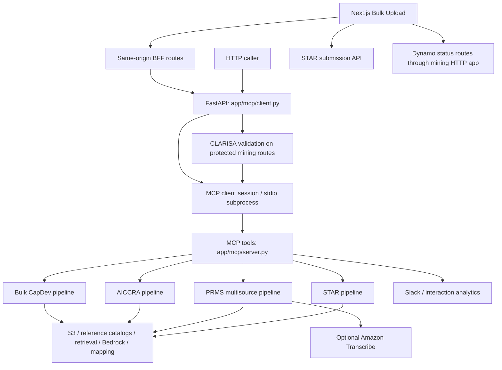

# Text Mining: high-level design

One FastAPI HTTP application dispatches four extraction workflows to MCP tools. STAR, PRMS, AICCRA, and Bulk CapDev share infrastructure helpers but retain separate orchestration, prompts, authentication, and output contracts. The Next.js Bulk Upload frontend is a separate application.

This document describes the development implementation. See the [API guide](API_GUIDE.md) for contracts and [branch differences](BRANCH_DIFFERENCES.md) for the service-main comparison.

## Component flow

The HTTP handlers initialize a stdio MCP session for mining calls. The MCP tool runs the corresponding synchronous product pipeline. Authentication occurs before dispatch at the HTTP layer for protected routes, with additional STAR management-token checks inside the STAR tools. It is not a single uniform middleware step after extraction.

## Implementation map

| Component | Location | Responsibility |
| --- | --- | --- |
| HTTP API | `app/mcp/client.py` | Routes, request schemas, uploads, CLARISA validation, MCP dispatch, helper APIs |
| MCP server | `app/mcp/server.py` | Four tool registrations, STAR auth, product invocation, notifications |
| STAR mining | `app/text_mining/star_mining/` | Single-document STAR extraction and response formatting |
| PRMS mining | `app/text_mining/prms_mining/` | Source normalization, extraction/transcription, per-source inference, validation |
| AICCRA mining | `app/text_mining/aiccra_mining/` | Default/custom-prompt document extraction |
| Bulk CapDev | `app/text_mining/bulk_upload/` | Spreadsheet batching, skipped IDs, mapping, result merge |
| Shared providers/helpers | `app/text_mining/providers/`, `shared/` | Bedrock invocation, vectorization/retrieval, reference caching, JSON parsing and field mapping |
| Schemas/prompts | `app/schemas/`, `app/utils/prompt/` | Product-specific output types and instructions |
| Bulk frontend | `frontend/components/BulkUpload/` | Upload/review/submission UI, table behavior, status integration |

## STAR and AICCRA

The HTTP layer requires a bucket and either a stored key or file. Uploads are written to S3 first, using the product prefix. The pipeline then loads geographic reference catalogs from that bucket/prefix and reads the source.

The shared reader supports PDF, DOCX, TXT, Excel, and PPTX. Ordinary text is split with an 8,000-character chunk size and 1,500-character overlap. Excel cleaning preserves meaningful rows as chunks. Embeddings are stored in temporary LanceDB data and relevant chunks are selected for the prompt.

STAR invokes the shared Bedrock provider, attempts mapping, and formats results with STAR schemas. AICCRA combines its default/custom prompt with selected text and reference catalogs; it parses recovered JSON or returns a text fallback. These paths do not use PRMS's final validation stage.

Alternate Supabase modules and older CLARISA connection helpers remain in development but are absent from the reviewed service-main tree. Their presence in development does not mean the active MCP tools dispatch to them.

## PRMS multisource pipeline

1. Normalize/deduplicate source keys and trim text. Create ordered source descriptors for documents, audio, and free text; enforce combined source limits.
2. Extract source text with bounded worker concurrency. Documents are downloaded/read; audio uses the configured transcriber. Any declared-source extraction failure aborts the request.
3. Build context per source. Small documents, free text, and audio transcripts are passed in full where possible; large documents use chunk retrieval. Context is trimmed under an estimated token budget.
4. Invoke extraction once per source, in bounded parallel workers, using the shared set of indicator prompts. Merge candidate arrays in stable source order.
5. Run final model validation across candidates to deduplicate and correct indicator fit. If JSON cannot be recovered, attempt one repair call before failing.
6. Attempt field mapping and institution cleanup per result. Mapping failure can retain the original result.
7. Apply PRMS Pydantic schemas and omit invalid/unknown candidates. Return formatted results and optionally attempt interaction tracking.

The active path is per-source model extraction followed by final validation, not the single combined extraction call described in the earlier draft specification. The current schemas support six indicator discriminators and exclude Knowledge Product. Inspect the schemas rather than assuming every extracted item survives final formatting.

Text-only requests can proceed without reference catalogs from a bucket. Documents may provide candidate formal evidence; audio/free text are context-only. Audio is disabled unless `PRMS_AUDIO_TRANSCRIBER` is configured, and its maximum duration is optional configuration.

The HTTP PRMS handler unwraps MCP text/error content. The other mining handlers return the MCP result envelope. These differences are part of the consuming-client contract.

## Bulk CapDev and review/submission

The Excel path reads meaningful rows, skips IDs already supplied by the caller, groups rows into batches of five, and processes batches with bounded thread pools (defaults include group size 20 and up to 20 workers). It merges batch results and attempts catalog/staff/institution mapping.

Batch failures can be represented inside returned data rather than failing the whole request. This differs from PRMS's declared-source failure semantics. The frontend therefore inspects and tracks individual records.

The Next.js app validates the user's token with the management API, checks roles, posts extraction through `/api/bulk-upload`, and lets users review/edit results. Submission to STAR and Dynamo status updates are distinct calls. The table includes current portfolio fields such as primary levers/research areas and strategic objectives.

Status data is stored per file in DynamoDB, with completed/failed ID lists, result links, and stored row metadata. Conditional writes and retry logic reduce lost updates on concurrent requests. A successfully tracked status does not independently prove successful extraction of every spreadsheet row.

## Configuration, resources, and deployment

The shared model provider invokes Claude Sonnet 4.6, reading the AWS region from configuration. The embedding client uses Titan Text Embeddings V2 in `us-east-1`. Additional module-level AWS clients exist; changing `AWS_REGION` does not uniformly reconfigure every client.

S3 holds inputs/reference files. LanceDB uses `/tmp/miningdb`. Logs go to the console and `/tmp/logs/app.log` with rotation. Bulk Dynamo tables depend on `IS_PROD`; analytics uses the URL in its interaction client. Optional mapping, Slack, and Amazon Transcribe have separate dependencies and failure behavior.

Importing the HTTP module attempts to verify/create the bulk DynamoDB table. Module imports can initialize AWS clients. These effects matter for offline tests and must be stubbed before importing the application when isolation is required.

`main.py` wraps the HTTP app with Mangum. The Dockerfile uses AWS Lambda Python 3.13, installs `requirements.txt`, copies configuration and the service tree, and runs `main.handler`. The local HTTP launcher is `python -m app.mcp.client` from the service directory. Frontend hosting uses SST/OpenNext and its own build lifecycle.

Local manifests, the development lockfile, and Lambda requirements are not identical. The reviewed lockfile contains LanceDB 0.21.2 while deployment requirements pin 0.36.0. Do not describe an untested lockfile environment as equivalent to the Lambda image.

## Access and validation boundaries

CLARISA protects STAR, PRMS, and Bulk CapDev HTTP mining routes. STAR tools additionally validate a management token, with roles required for bulk. AICCRA does not currently validate its optional token fields. Auxiliary endpoints do not all have CLARISA dependencies. Base64 encoding in the UI token helper is not encryption or proof of route access control.

There is no universal application-level deadline or deployment SLA established by this code. Shared Bedrock calls have configured connection/read timeouts, but tool orchestration, retries, transcription, mapping, analytics, and notifications can add time. The local process status is not a live check of every dependency.

Static OpenAPI descriptions and some analytics model labels mention older models. Current model selection is defined by the provider. Documentation changes do not repair those labels, access behavior, or dependency differences.

Existing tests under `tests/prms/` cover normalization, source/model orchestration, schemas, prompts, mapping helpers, transcription, and the PRMS HTTP contract. They do not establish extraction accuracy for real documents or live STAR/CLARISA/S3 behavior. See [validation instructions](../README.md#validation) before running them.
